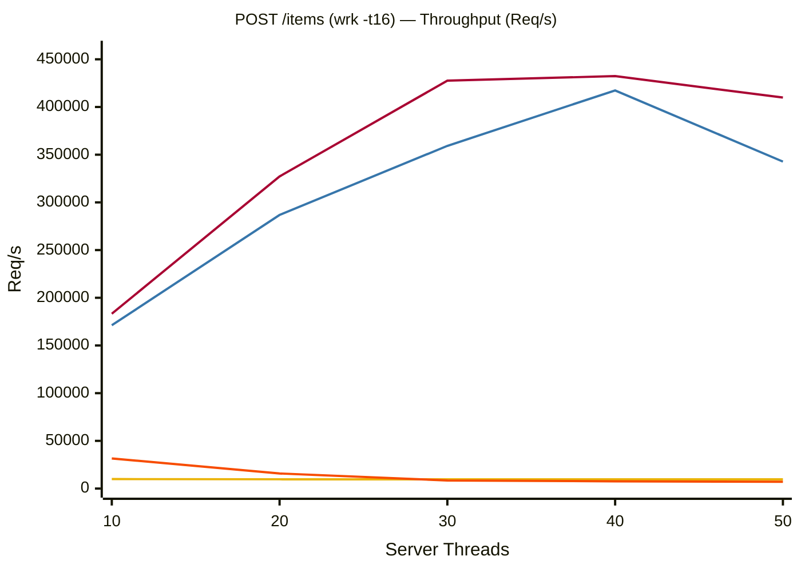
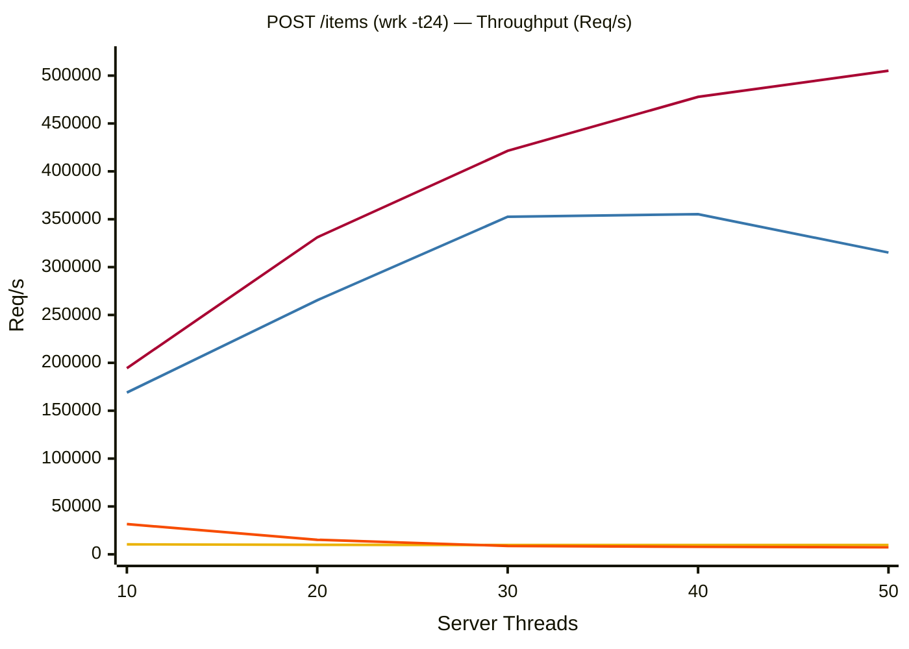
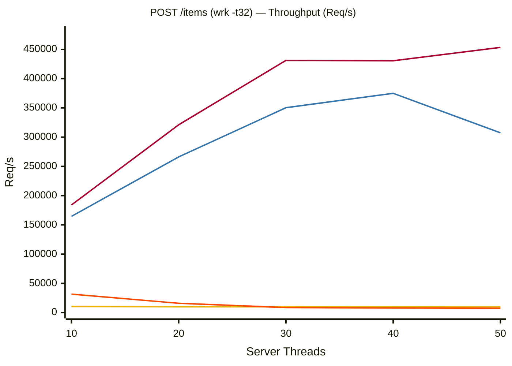
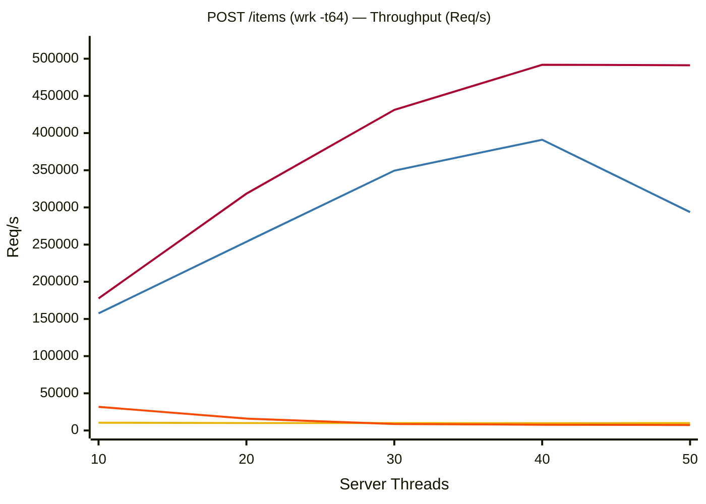

# EPython

**A GIL-free Python interpreter powered by Erlang/OTP's BEAM VM — built to shine on multithreaded I/O workloads.** `EPython` runs Python `threading.Thread` workers concurrently across CPU cores with preemptive scheduling, sharing in-memory Python state across threads without a Global Interpreter Lock or multi-process workers.

> **Status:** This project is under active development.
>
> **Trade-off:** `EPython` is slower than CPython on single-threaded, compute-heavy, sequential, or single-loop `asyncio` workloads. Its strength is concurrent multithreaded I/O (`threading.Thread` handling high-concurrency I/O with shared state across many cores).

## C10K Multithreaded I/O Benchmark

[`threaded_server.py`](threaded_server.py) + [`post.lua`](post.lua): multithreaded `selectors` + `SO_REUSEPORT` HTTP server that parses JSON, computes a pure-Python FNV-1a hash, and updates a 64-shard locked dict on every `POST /items`.

### Results

Strictly sequential 30s runs at `-c10000` across 10, 20, 30, 40, and 50 server threads for `wrk -t16`, `-t24`, `-t32`, and `-t64` (0 socket errors, 0 non-2xx across all 80 runs). `EPython 0.1.0` leads on throughput, `p50`, and CPU/req in **all 20 / 20** configurations — peaking at **505,087 req/s** (`wrk -t24`, 50t; **+60.2%** over CPython 3.13.6t FT, **52.1×** CPython GIL, **69.5×** RustPython) and **491,233 req/s** (`wrk -t64`, 50t; **+67.3%** over CPython 3.13.6t FT with **9.9×** lower `p99`: `70.60ms` vs `696.03ms`).

#### `wrk -t16 -c10000 -d30s`


Legend: 🟥 **EPython 0.1.0** · 🟦 **CPython 3.13.6t (FT)** · 🟨 **CPython 3.13.18 (GIL)** · 🟧 **RustPython 0.6.0**

<details>
<summary><strong>View detailed numbers — wrk -t16 (10, 20, 30, 40, 50 server threads)</strong></summary>

#### 10 server threads (`wrk -t16 -c10000 -d30s`)

| Interpreter | Req/s | Avg | p50 | p99 | Max | Steady CPU/req (user / sys / total) |
|---|--:|--:|--:|--:|--:|--:|
| **EPython 0.1.0** | **183,293** | **55.02ms** | **50.46ms** | **111.86ms** | **410.70ms** | **25.92 / 25.25 / 51.17 µs** |
| CPython 3.13.6t (FT) | 171,193 | 58.00ms | 54.64ms | 85.20ms | 170.67ms | 35.51 / 22.85 / 58.36 µs |
| RustPython 0.6.0 | 31,548 | 313.45ms | 310.02ms | 558.63ms | 676.07ms | 212.57 / 77.46 / 290.03 µs |
| CPython 3.13.18 (GIL) | 9,909 | 986.98ms | 974.89ms | 1.44s | 1.86s | 68.37 / 68.33 / 136.71 µs |

#### 20 server threads (`wrk -t16 -c10000 -d30s`)

| Interpreter | Req/s | Avg | p50 | p99 | Max | Steady CPU/req (user / sys / total) |
|---|--:|--:|--:|--:|--:|--:|
| **EPython 0.1.0** | **327,172** | **30.53ms** | **28.47ms** | **65.75ms** | **294.58ms** | **29.40 / 24.29 / 53.69 µs** |
| CPython 3.13.6t (FT) | 286,849 | 34.63ms | 33.56ms | 55.86ms | 140.98ms | 45.25 / 24.35 / 69.60 µs |
| RustPython 0.6.0 | 15,829 | 621.87ms | 625.85ms | 713.43ms | 1.15s | 402.02 / 375.15 / 777.17 µs |
| CPython 3.13.18 (GIL) | 9,726 | 1.01s | 991.63ms | 1.39s | 2.26s | 69.45 / 70.65 / 140.09 µs |

#### 30 server threads (`wrk -t16 -c10000 -d30s`)

| Interpreter | Req/s | Avg | p50 | p99 | Max | Steady CPU/req (user / sys / total) |
|---|--:|--:|--:|--:|--:|--:|
| **EPython 0.1.0** | **427,601** | **33.99ms** | **16.21ms** | **397.84ms** | **532.47ms** | **32.11 / 24.80 / 56.91 µs** |
| CPython 3.13.6t (FT) | 359,254 | 27.46ms | 26.35ms | 54.78ms | 119.59ms | 53.71 / 25.29 / 78.99 µs |
| CPython 3.13.18 (GIL) | 9,712 | 1.01s | 998.53ms | 1.44s | 2.13s | 68.69 / 71.78 / 140.46 µs |
| RustPython 0.6.0 | 8,500 | 1.15s | 1.15s | 1.35s | 2.54s | 554.07 / 733.87 / 1,287.93 µs |

#### 40 server threads (`wrk -t16 -c10000 -d30s`)

| Interpreter | Req/s | Avg | p50 | p99 | Max | Steady CPU/req (user / sys / total) |
|---|--:|--:|--:|--:|--:|--:|
| **EPython 0.1.0** | **432,361** | **45.67ms** | **12.93ms** | **419.68ms** | **532.17ms** | **30.57 / 25.60 / 56.18 µs** |
| CPython 3.13.6t (FT) | 417,353 | 25.43ms | 19.04ms | 306.35ms | 674.89ms | 66.26 / 26.60 / 92.85 µs |
| CPython 3.13.18 (GIL) | 9,656 | 1.01s | 1.00s | 1.43s | 2.42s | 69.38 / 72.49 / 141.87 µs |
| RustPython 0.6.0 | 7,597 | 1.28s | 1.29s | 1.52s | 2.76s | 616.71 / 816.06 / 1,432.77 µs |

#### 50 server threads (`wrk -t16 -c10000 -d30s`)

| Interpreter | Req/s | Avg | p50 | p99 | Max | Steady CPU/req (user / sys / total) |
|---|--:|--:|--:|--:|--:|--:|
| **EPython 0.1.0** | **409,928** | **45.82ms** | **12.09ms** | **403.49ms** | **537.23ms** | **31.52 / 26.47 / 57.99 µs** |
| CPython 3.13.6t (FT) | 342,737 | 45.69ms | 26.05ms | 779.68ms | 1.16s | 63.48 / 28.00 / 91.49 µs |
| CPython 3.13.18 (GIL) | 9,682 | 1.01s | 1.00s | 1.41s | 2.22s | 68.34 / 73.76 / 142.10 µs |
| RustPython 0.6.0 | 7,101 | 1.37s | 1.37s | 1.61s | 2.89s | 679.88 / 886.66 / 1,566.54 µs |

</details>

#### `wrk -t24 -c10000 -d30s`


Legend: 🟥 **EPython 0.1.0** · 🟦 **CPython 3.13.6t (FT)** · 🟨 **CPython 3.13.18 (GIL)** · 🟧 **RustPython 0.6.0**

<details>
<summary><strong>View detailed numbers — wrk -t24 (10, 20, 30, 40, 50 server threads)</strong></summary>

#### 10 server threads (`wrk -t24 -c10000 -d30s`)

| Interpreter | Req/s | Avg | p50 | p99 | Max | Steady CPU/req (user / sys / total) |
|---|--:|--:|--:|--:|--:|--:|
| **EPython 0.1.0** | **194,391** | **51.80ms** | **49.52ms** | **79.11ms** | **352.88ms** | **24.71 / 24.46 / 49.17 µs** |
| CPython 3.13.6t (FT) | 168,933 | 59.00ms | 55.91ms | 87.15ms | 212.25ms | 35.85 / 23.29 / 59.14 µs |
| RustPython 0.6.0 | 31,543 | 313.74ms | 312.94ms | 373.34ms | 642.71ms | 208.63 / 79.76 / 288.39 µs |
| CPython 3.13.18 (GIL) | 10,398 | 943.42ms | 935.68ms | 1.25s | 1.67s | 63.11 / 66.52 / 129.63 µs |

#### 20 server threads (`wrk -t24 -c10000 -d30s`)

| Interpreter | Req/s | Avg | p50 | p99 | Max | Steady CPU/req (user / sys / total) |
|---|--:|--:|--:|--:|--:|--:|
| **EPython 0.1.0** | **331,119** | **30.43ms** | **29.35ms** | **54.56ms** | **257.79ms** | **30.79 / 25.64 / 56.43 µs** |
| CPython 3.13.6t (FT) | 265,390 | 37.45ms | 37.83ms | 58.92ms | 163.58ms | 48.19 / 27.07 / 75.26 µs |
| RustPython 0.6.0 | 15,186 | 648.28ms | 653.15ms | 741.30ms | 1.40s | 412.39 / 382.15 / 794.54 µs |
| CPython 3.13.18 (GIL) | 9,926 | 986.52ms | 979.45ms | 1.36s | 1.97s | 63.38 / 72.83 / 136.21 µs |

#### 30 server threads (`wrk -t24 -c10000 -d30s`)

| Interpreter | Req/s | Avg | p50 | p99 | Max | Steady CPU/req (user / sys / total) |
|---|--:|--:|--:|--:|--:|--:|
| **EPython 0.1.0** | **421,401** | **23.70ms** | **21.14ms** | **58.19ms** | **262.32ms** | **31.09 / 24.36 / 55.46 µs** |
| CPython 3.13.6t (FT) | 352,548 | 28.20ms | 27.72ms | 48.78ms | 134.94ms | 56.22 / 27.60 / 83.82 µs |
| CPython 3.13.18 (GIL) | 9,699 | 1.01s | 1.00s | 1.43s | 2.20s | 66.29 / 74.06 / 140.35 µs |
| RustPython 0.6.0 | 8,727 | 1.12s | 1.13s | 1.27s | 2.45s | 571.24 / 695.23 / 1,266.48 µs |

#### 40 server threads (`wrk -t24 -c10000 -d30s`)

| Interpreter | Req/s | Avg | p50 | p99 | Max | Steady CPU/req (user / sys / total) |
|---|--:|--:|--:|--:|--:|--:|
| **EPython 0.1.0** | **477,779** | **19.96ms** | **16.47ms** | **63.32ms** | **484.39ms** | **32.44 / 25.54 / 57.99 µs** |
| CPython 3.13.6t (FT) | 355,248 | 29.10ms | 25.83ms | 71.56ms | 369.34ms | 61.38 / 28.33 / 89.71 µs |
| CPython 3.13.18 (GIL) | 9,749 | 1.00s | 992.03ms | 1.49s | 2.40s | 66.42 / 73.64 / 140.05 µs |
| RustPython 0.6.0 | 7,794 | 1.25s | 1.26s | 1.44s | 2.80s | 614.01 / 775.45 / 1,389.45 µs |

#### 50 server threads (`wrk -t24 -c10000 -d30s`)

| Interpreter | Req/s | Avg | p50 | p99 | Max | Steady CPU/req (user / sys / total) |
|---|--:|--:|--:|--:|--:|--:|
| **EPython 0.1.0** | **505,087** | **18.38ms** | **13.39ms** | **107.89ms** | **416.27ms** | **34.44 / 27.05 / 61.49 µs** |
| CPython 3.13.6t (FT) | 315,231 | 42.42ms | 29.51ms | 573.72ms | 923.02ms | 60.48 / 30.07 / 90.54 µs |
| CPython 3.13.18 (GIL) | 9,694 | 1.01s | 998.65ms | 1.42s | 2.66s | 67.91 / 73.80 / 141.71 µs |
| RustPython 0.6.0 | 7,272 | 1.34s | 1.37s | 1.53s | 3.00s | 675.29 / 855.02 / 1,530.31 µs |

</details>

#### `wrk -t32 -c10000 -d30s`


Legend: 🟥 **EPython 0.1.0** · 🟦 **CPython 3.13.6t (FT)** · 🟨 **CPython 3.13.18 (GIL)** · 🟧 **RustPython 0.6.0**

<details>
<summary><strong>View detailed numbers — wrk -t32 (10, 20, 30, 40, 50 server threads)</strong></summary>

#### 10 server threads (`wrk -t32 -c10000 -d30s`)

| Interpreter | Req/s | Avg | p50 | p99 | Max | Steady CPU/req (user / sys / total) |
|---|--:|--:|--:|--:|--:|--:|
| **EPython 0.1.0** | **184,046** | **55.39ms** | **52.86ms** | **93.30ms** | **424.55ms** | **25.84 / 25.72 / 51.56 µs** |
| CPython 3.13.6t (FT) | 164,565 | 60.53ms | 59.40ms | 86.63ms | 199.30ms | 37.01 / 23.73 / 60.74 µs |
| RustPython 0.6.0 | 31,577 | 313.75ms | 313.04ms | 381.79ms | 606.75ms | 206.94 / 81.48 / 288.42 µs |
| CPython 3.13.18 (GIL) | 10,449 | 937.97ms | 933.55ms | 1.26s | 1.88s | 62.17 / 67.03 / 129.20 µs |

#### 20 server threads (`wrk -t32 -c10000 -d30s`)

| Interpreter | Req/s | Avg | p50 | p99 | Max | Steady CPU/req (user / sys / total) |
|---|--:|--:|--:|--:|--:|--:|
| **EPython 0.1.0** | **321,100** | **31.70ms** | **30.17ms** | **55.67ms** | **346.59ms** | **30.92 / 27.07 / 57.99 µs** |
| CPython 3.13.6t (FT) | 266,210 | 37.54ms | 37.26ms | 56.29ms | 175.63ms | 48.00 / 27.01 / 75.00 µs |
| RustPython 0.6.0 | 15,961 | 617.92ms | 623.02ms | 703.32ms | 1.31s | 405.45 / 365.11 / 770.56 µs |
| CPython 3.13.18 (GIL) | 9,926 | 987.97ms | 979.20ms | 1.37s | 2.06s | 65.14 / 71.11 / 136.25 µs |

#### 30 server threads (`wrk -t32 -c10000 -d30s`)

| Interpreter | Req/s | Avg | p50 | p99 | Max | Steady CPU/req (user / sys / total) |
|---|--:|--:|--:|--:|--:|--:|
| **EPython 0.1.0** | **431,185** | **23.22ms** | **20.65ms** | **56.85ms** | **286.35ms** | **30.91 / 24.77 / 55.68 µs** |
| CPython 3.13.6t (FT) | 350,290 | 28.57ms | 27.74ms | 48.53ms | 201.65ms | 57.29 / 27.92 / 85.22 µs |
| CPython 3.13.18 (GIL) | 9,869 | 993.25ms | 987.78ms | 1.40s | 1.90s | 65.90 / 71.52 / 137.42 µs |
| RustPython 0.6.0 | 8,610 | 1.14s | 1.14s | 1.34s | 1.54s | 550.45 / 709.28 / 1,259.73 µs |

#### 40 server threads (`wrk -t32 -c10000 -d30s`)

| Interpreter | Req/s | Avg | p50 | p99 | Max | Steady CPU/req (user / sys / total) |
|---|--:|--:|--:|--:|--:|--:|
| **EPython 0.1.0** | **430,525** | **23.58ms** | **20.09ms** | **72.87ms** | **358.55ms** | **31.32 / 25.14 / 56.46 µs** |
| CPython 3.13.6t (FT) | 374,877 | 28.26ms | 24.04ms | 83.19ms | 429.28ms | 62.12 / 28.49 / 90.61 µs |
| CPython 3.13.18 (GIL) | 9,755 | 1.00s | 999.69ms | 1.45s | 2.05s | 68.21 / 71.76 / 139.97 µs |
| RustPython 0.6.0 | 7,934 | 1.23s | 1.24s | 1.43s | 2.55s | 606.16 / 768.38 / 1,374.54 µs |

#### 50 server threads (`wrk -t32 -c10000 -d30s`)

| Interpreter | Req/s | Avg | p50 | p99 | Max | Steady CPU/req (user / sys / total) |
|---|--:|--:|--:|--:|--:|--:|
| **EPython 0.1.0** | **453,398** | **22.19ms** | **18.94ms** | **69.08ms** | **318.15ms** | **33.75 / 26.34 / 60.08 µs** |
| CPython 3.13.6t (FT) | 307,368 | 43.58ms | 30.45ms | 590.30ms | 975.16ms | 57.45 / 30.64 / 88.08 µs |
| CPython 3.13.18 (GIL) | 9,731 | 1.01s | 995.37ms | 1.48s | 2.21s | 68.85 / 72.49 / 141.34 µs |
| RustPython 0.6.0 | 7,433 | 1.31s | 1.32s | 1.54s | 2.89s | 673.74 / 842.41 / 1,516.15 µs |

</details>

#### `wrk -t64 -c10000 -d30s`


Legend: 🟥 **EPython 0.1.0** · 🟦 **CPython 3.13.6t (FT)** · 🟨 **CPython 3.13.18 (GIL)** · 🟧 **RustPython 0.6.0**

<details>
<summary><strong>View detailed numbers — wrk -t64 (10, 20, 30, 40, 50 server threads)</strong></summary>

#### 10 server threads (`wrk -t64 -c10000 -d30s`)

| Interpreter | Req/s | Avg | p50 | p99 | Max | Steady CPU/req (user / sys / total) |
|---|--:|--:|--:|--:|--:|--:|
| **EPython 0.1.0** | **177,588** | **56.96ms** | **54.97ms** | **82.06ms** | **416.57ms** | **26.94 / 26.65 / 53.60 µs** |
| CPython 3.13.6t (FT) | 157,480 | 63.42ms | 62.40ms | 88.07ms | 215.98ms | 38.17 / 25.27 / 63.44 µs |
| RustPython 0.6.0 | 31,792 | 312.58ms | 312.49ms | 380.98ms | 455.35ms | 206.18 / 79.80 / 285.99 µs |
| CPython 3.13.18 (GIL) | 10,479 | 938.83ms | 935.32ms | 1.25s | 1.64s | 63.10 / 65.45 / 128.55 µs |

#### 20 server threads (`wrk -t64 -c10000 -d30s`)

| Interpreter | Req/s | Avg | p50 | p99 | Max | Steady CPU/req (user / sys / total) |
|---|--:|--:|--:|--:|--:|--:|
| **EPython 0.1.0** | **318,483** | **32.13ms** | **30.36ms** | **55.02ms** | **395.81ms** | **30.50 / 27.65 / 58.14 µs** |
| CPython 3.13.6t (FT) | 253,820 | 39.33ms | 38.79ms | 58.09ms | 138.52ms | 49.07 / 29.62 / 78.68 µs |
| RustPython 0.6.0 | 15,965 | 619.12ms | 626.08ms | 727.42ms | 1.24s | 394.81 / 371.32 / 766.12 µs |
| CPython 3.13.18 (GIL) | 9,984 | 984.12ms | 976.93ms | 1.38s | 1.81s | 64.94 / 70.74 / 135.67 µs |

#### 30 server threads (`wrk -t64 -c10000 -d30s`)

| Interpreter | Req/s | Avg | p50 | p99 | Max | Steady CPU/req (user / sys / total) |
|---|--:|--:|--:|--:|--:|--:|
| **EPython 0.1.0** | **431,137** | **23.95ms** | **21.65ms** | **51.29ms** | **402.31ms** | **34.29 / 27.77 / 62.06 µs** |
| CPython 3.13.6t (FT) | 349,458 | 28.57ms | 27.93ms | 47.88ms | 134.36ms | 56.05 / 29.04 / 85.09 µs |
| CPython 3.13.18 (GIL) | 10,000 | 982.11ms | 973.83ms | 1.38s | 2.01s | 65.58 / 70.00 / 135.58 µs |
| RustPython 0.6.0 | 8,753 | 1.12s | 1.14s | 1.30s | 2.31s | 534.69 / 709.16 / 1,243.86 µs |

#### 40 server threads (`wrk -t64 -c10000 -d30s`)

| Interpreter | Req/s | Avg | p50 | p99 | Max | Steady CPU/req (user / sys / total) |
|---|--:|--:|--:|--:|--:|--:|
| **EPython 0.1.0** | **491,831** | **21.61ms** | **17.68ms** | **65.81ms** | **448.95ms** | **34.54 / 28.12 / 62.67 µs** |
| CPython 3.13.6t (FT) | 391,047 | 27.04ms | 23.61ms | 70.06ms | 450.60ms | 65.18 / 29.04 / 94.23 µs |
| CPython 3.13.18 (GIL) | 9,785 | 1.00s | 996.57ms | 1.40s | 2.26s | 69.67 / 70.09 / 139.76 µs |
| RustPython 0.6.0 | 7,760 | 1.26s | 1.27s | 1.46s | 2.68s | 606.11 / 793.54 / 1,399.64 µs |

#### 50 server threads (`wrk -t64 -c10000 -d30s`)

| Interpreter | Req/s | Avg | p50 | p99 | Max | Steady CPU/req (user / sys / total) |
|---|--:|--:|--:|--:|--:|--:|
| **EPython 0.1.0** | **491,233** | **21.55ms** | **17.43ms** | **70.60ms** | **441.48ms** | **36.31 / 28.99 / 65.30 µs** |
| CPython 3.13.6t (FT) | 293,681 | 48.29ms | 31.88ms | 696.03ms | 1.12s | 57.80 / 32.10 / 89.90 µs |
| CPython 3.13.18 (GIL) | 9,909 | 990.94ms | 984.06ms | 1.41s | 2.21s | 66.73 / 71.78 / 138.51 µs |
| RustPython 0.6.0 | 7,422 | 1.32s | 1.33s | 1.59s | 2.67s | 658.80 / 855.62 / 1,514.42 µs |

</details>

### Setup

macOS:

```sh
brew install wrk
sudo sysctl -w kern.ipc.somaxconn=16384
```

Linux:

```sh
sudo apt install wrk
sudo sysctl -w fs.file-max=2000000 net.core.somaxconn=65535 net.ipv4.tcp_max_syn_backlog=65535
sudo sysctl -w net.ipv4.ip_local_port_range="1024 65535" net.ipv4.tcp_tw_reuse=1
sudo sysctl -w kernel.threads-max=4194304 kernel.pid_max=4194304 vm.max_map_count=1048576
```

### Run

```sh
# terminal 1 (arguments: [port=8000] [num_threads=cpu_count])
ulimit -n 65536 && epython threaded_server.py 8000 50

# terminal 2
ulimit -n 65536 && wrk -t24 -c10000 -d30s --timeout 5s --latency -s post.lua http://127.0.0.1:8000/items
```

No `Socket errors:` line means all 10,000 connections completed cleanly with 0 errors.

### Machine

| Spec | Value |
|---|---|
| **CPU** | AMD EPYC 7B13 (64 vCPUs — 32 cores / 64 threads, x86_64) |
| **Cache** | 1 MiB L1d, 1 MiB L1i, 16 MiB L2, 128 MiB L3 |
| **Memory** | 117 GiB RAM |
| **OS / Kernel** | Debian GNU/Linux, Linux 7.1.6 (`x86_64`, `SMP PREEMPT_DYNAMIC`) |
| **Runtimes** | `EPython 0.1.0` (Erlang/OTP 29, ERTS 17.0.4), `CPython 3.13.18`, `CPython 3.13.6t` (free-threaded), `RustPython 0.6.0` (`rustc 1.100.0`) |
| **Kernel TCP** | `somaxconn=4096`, `tcp_max_syn_backlog=4096`, `ip_local_port_range=1024 65535`, `tcp_tw_reuse=1` |
