# EPython

**A GIL-free Python 3.13 interpreter on Erlang/OTP's BEAM VM — built to become the de facto Python runtime for high-concurrency network servers.**

`EPython` scales unmodified Python `threading.Thread`, `multiprocessing.Process`, and `asyncio` network code across CPU cores with preemptive BEAM scheduling and zero GIL — shipped as a single self-contained binary with `pip` built in.

> [!NOTE]
> Under active development. Pre-release standalone binaries (with `SHA256SUMS`) are published on [Releases](https://github.com/erlpython/epython/releases/latest) for evaluation and benchmarking.

| Best fit | Not a fit |
|---|---|
| High-concurrency HTTP & WSGI servers (`Django`, `Waitress`, `selectors`, `threading`, `multiprocessing`) | Single-threaded CLI scripts and sequential batch jobs |
| JSON APIs, serialization, and concurrent streaming (`asyncio` / async generators) | Single-threaded CPU-bound numeric or parsing loops |
| Multi-core Python services sharing in-memory state across 16–64+ threads | Drop-in speedups for single-threaded CPython scripts |

---

## Install

Download a standalone binary from [Releases](https://github.com/erlpython/epython/releases/latest) (Linux `x86_64`/`arm64`, macOS `arm64`/`x86_64` — bundles Erlang/OTP, OpenSSL, and `pip`):

```sh
F=epython-0.1.0-linux-x86_64-standalone   # or linux-arm64 / macos-arm64 / macos-x86_64
curl -LO "https://github.com/erlpython/epython/releases/download/v0.1.0/$F"
chmod +x "$F" && mv "$F" ~/.local/bin/epython
```

```sh
epython script.py                      # run a script
epython -m pip install fastapi httpx   # install pure-Python & cp313/abi3 wheels
```

---

## Django Benchmark

Unmodified [`django_server.py`](django_server.py) (`Django 6.1.3`) across all four runtimes in a single process with no `os.fork()` (see [Test Machine](#test-machine)):

- **Django + Waitress `SO_REUSEPORT`** ([`django_waitress_server.py`](django_waitress_server.py) using stock `waitress.create_server`, `wrk -t8 -c200 -d10s --latency`, **0 errors** across all 10 EPython runs): `EPython 0.1.0` sweeps `/template/` in **all 5 / 5** configs (**2,320 req/s** at `16×1` — **1.39×** CPython FT, **2.79×** CPython GIL, **7.05×** RustPython; **8.90×** CPython FT at `64×1` where CPython FT drops to `200 req/s` with 81 timeouts). On `/json/`, `EPython` overtakes CPython FT at `32×1` (**9,203 vs. 8,932**, **6.2× lower `p99`**) and peaks at **10,528 req/s** at `48×1` (**12.1×** CPython FT, **6.29×** CPython GIL, **20.3×** RustPython) and **9,679 req/s** at `64×1` (**14.2×** CPython FT, **18.3×** RustPython).
- **Django Pure Multi-Thread Scaling** (`1t`–`64t` calling `django_server.application` directly across `threading.Thread` workers): `EPython 0.1.0` scales **20.4×** on `/json/` (`2,033 → 41,412 req/s`), beating CPython FT by **1.98× at `32t`**, **26.3× at `48t`**, and **29.2× at `64t`** (and **7.8×** CPython GIL / **32.9×** RustPython at `64t`), and leads `/template/` from `16t` through `64t` (**2,460 req/s** at `16t` — **1.60×** CPython FT, **6.0×** CPython GIL, **7.1×** RustPython).

<table>
<tr>
<td width="440">

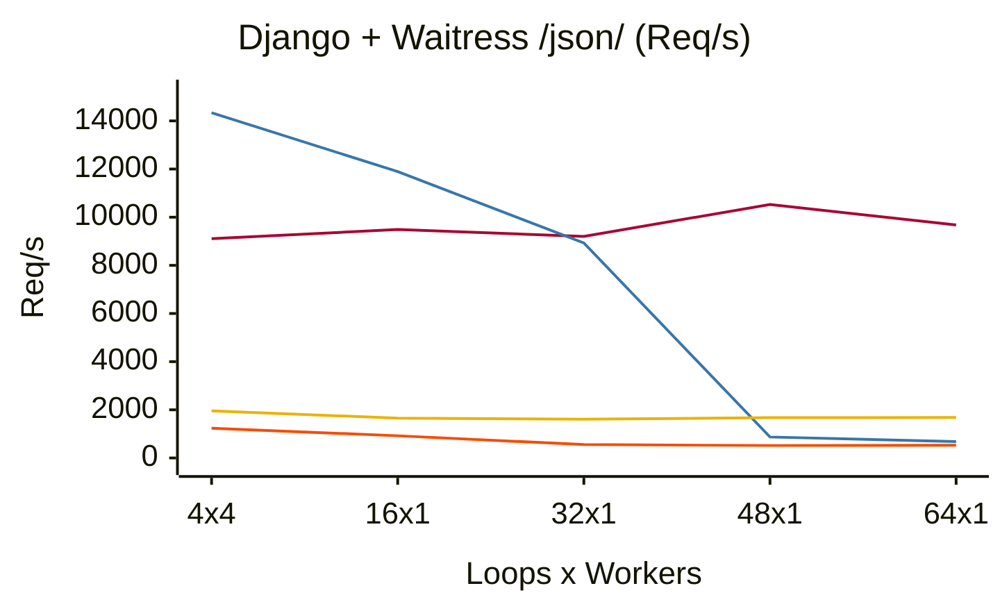

</td>
<td width="440">

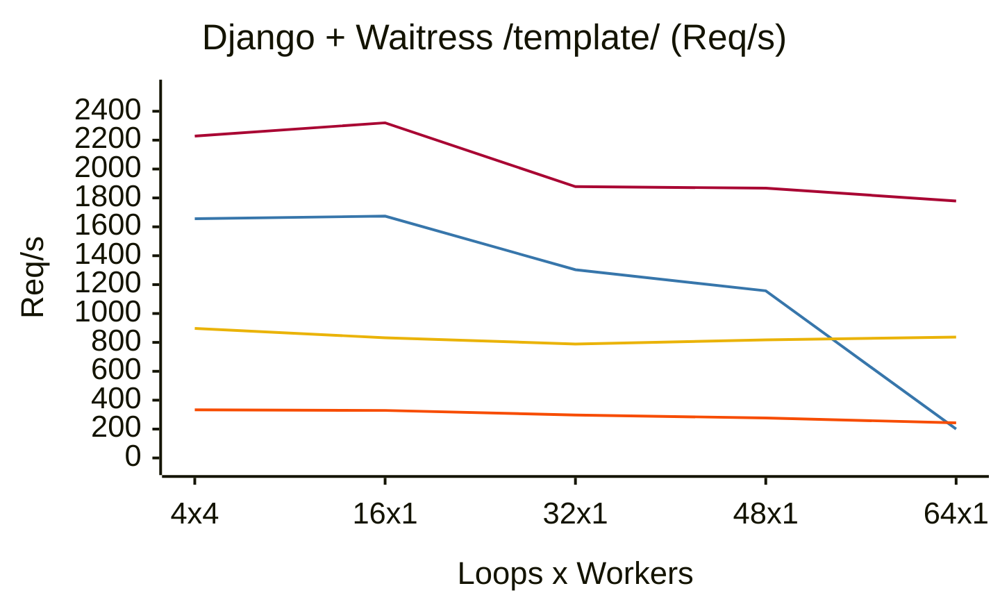

</td>
</tr>
<tr>
<td width="440">

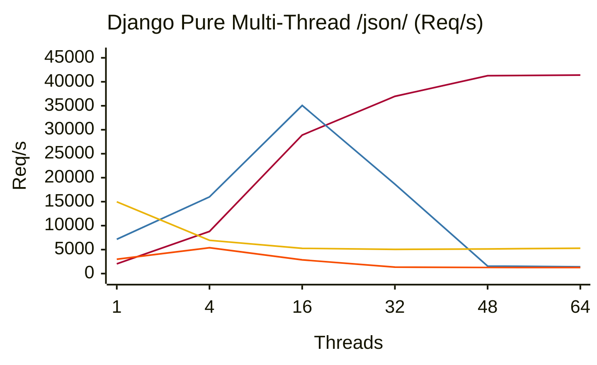

</td>
<td width="440">

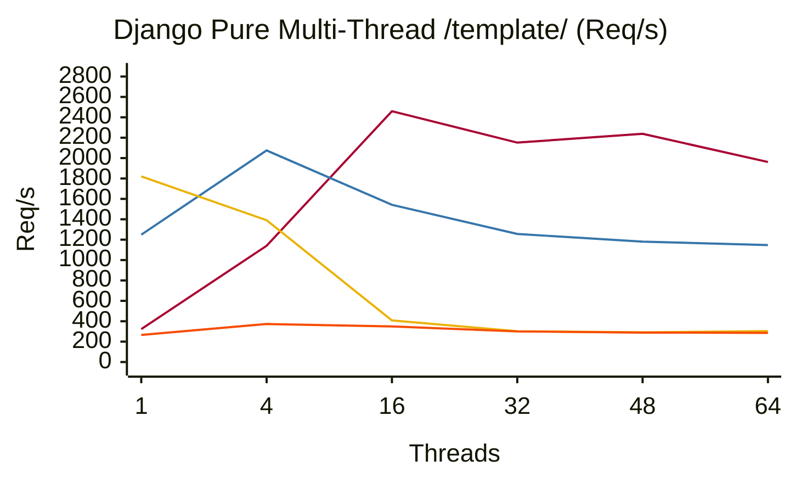

</td>
</tr>
</table>

**Legend:** 🟥 **EPython 0.1.0** · 🟦 **CPython 3.13.6t (FT)** · 🟨 **CPython 3.13.18 (GIL)** · 🟧 **RustPython 0.6.0**

<details>
<summary><strong>View Django numbers &amp; reproduce commands</strong></summary>

#### Django + Waitress `SO_REUSEPORT` (`django_waitress_server.py`, `wrk -t8 -c200 -d10s --latency`)

| Config (`loops × workers`) | Endpoint | **EPython 0.1.0** (`p50` / `p99`, err) | CPython 3.13.6t FT (`p50` / `p99`, err) | CPython 3.13.18 GIL (`p50` / `p99`, err) | RustPython 0.6.0 (`p50` / `p99`, err) |
|---|---|--:|--:|--:|--:|
| `4×4` | `/template/` | **2,228** (`86.9ms` / `129.6ms`, `0`) | 1,656 (`117.8ms` / `159.6ms`, `0`) | 897 (`188.5ms` / `1.02s`, `63t`) | 333 (`582.3ms` / `701.8ms`, `0`) |
| `16×1` | `/template/` | **2,320** (`83.0ms` / `141.9ms`, `0`) | 1,674 (`118.9ms` / `206.3ms`, `0`) | 832 (`219.8ms` / `906.2ms`, `8t`) | 329 (`551.9ms` / `987.8ms`, `0`) |
| `32×1` | `/template/` | **1,878** (`103.4ms` / `201.5ms`, `0`) | 1,303 (`138.3ms` / `277.3ms`, `0`) | 789 (`236.8ms` / `758.1ms`, `0`) | 297 (`653.2ms` / `1.50s`, `0`) |
| `48×1` | `/template/` | **1,868** (`102.1ms` / `283.6ms`, `0`) | 1,157 (`168.1ms` / `688.6ms`, `0`) | 817 (`259.7ms` / `1.10s`, `6t`) | 277 (`649.6ms` / `1.59s`, `0`) |
| `64×1` | `/template/` | **1,779** (`107.8ms` / `248.8ms`, `0`) | 200 (`863.0ms` / `1.80s`, `81t`) | 837 (`214.8ms` / `1.55s`, `30t`) | 243 (`727.4ms` / `1.89s`, `10t`) |
| `4×4` | `/json/` | 9,106 (`20.4ms` / `92.0ms`, `0`) | **14,338** (`13.1ms` / `33.3ms`, `0`) | 1,955 (`92.0ms` / `1.06s`, `11t`) | 1,237 (`158.3ms` / `243.3ms`, `0`) |
| `16×1` | `/json/` | 9,488 (`20.0ms` / `45.2ms`, `0`) | **11,895** (`16.2ms` / `34.6ms`, `0`) | 1,654 (`111.2ms` / `365.4ms`, `0`) | 922 (`219.3ms` / `1.13s`, `0`) |
| `32×1` | `/json/` | **9,203** (`20.9ms` / `53.8ms`, `0`) | 8,932 (`19.9ms` / `334.7ms`, `0`) | 1,609 (`118.0ms` / `395.9ms`, `0`) | 555 (`325.8ms` / `970.6ms`, `46t`) |
| `48×1` | `/json/` | **10,528** (`19.2ms` / `64.7ms`, `0`) | 871 (`235.9ms` / `919.3ms`, `0`) | 1,674 (`126.6ms` / `576.4ms`, `0`) | 518 (`333.3ms` / `856.5ms`, `63t`) |
| `64×1` | `/json/` | **9,679** (`19.3ms` / `83.4ms`, `0`) | 683 (`260.6ms` / `696.2ms`, `0`) | 1,681 (`135.7ms` / `1.06s`, `3t`) | 528 (`145.2ms` / `758.9ms`, `135t`) |

*(Timeout counts denoted with `t`, e.g. `81t` = 81 socket read timeouts during the 10s run.)*

#### Django Pure Multi-Thread Scaling (`1t`–`64t`, direct WSGI calls)

| Endpoint | Threads | **EPython 0.1.0** | CPython 3.13.6t FT | CPython 3.13.18 GIL | RustPython 0.6.0 | EPython vs. FT |
|---|--:|--:|--:|--:|--:|--:|
| `/json/` | `1t` | 2,033 req/s | 7,152 req/s | **14,976 req/s** | 2,994 req/s | 0.28× |
| `/json/` | `4t` | 8,791 req/s | **15,997 req/s** | 6,936 req/s | 5,386 req/s | 0.55× |
| `/json/` | `16t` | 28,894 req/s | **35,063 req/s** | 5,271 req/s | 2,858 req/s | 0.82× |
| `/json/` | `32t` | **36,969 req/s** | 18,656 req/s | 5,046 req/s | 1,345 req/s | **1.98× faster** |
| `/json/` | `48t` | **41,277 req/s** | 1,569 req/s | 5,141 req/s | 1,274 req/s | **26.3× faster** |
| `/json/` | `64t` | **41,412 req/s** | 1,418 req/s | 5,289 req/s | 1,257 req/s | **29.2× faster** |
| `/template/` | `1t` | 323 req/s | 1,249 req/s | **1,820 req/s** | 266 req/s | 0.26× |
| `/template/` | `4t` | 1,140 req/s | **2,075 req/s** | 1,391 req/s | 373 req/s | 0.55× |
| `/template/` | `16t` | **2,460 req/s** | 1,542 req/s | 408 req/s | 349 req/s | **1.60× faster** |
| `/template/` | `32t` | **2,152 req/s** | 1,256 req/s | 302 req/s | 300 req/s | **1.71× faster** |
| `/template/` | `48t` | **2,238 req/s** | 1,181 req/s | 291 req/s | 289 req/s | **1.90× faster** |
| `/template/` | `64t` | **1,962 req/s** | 1,147 req/s | 304 req/s | 286 req/s | **1.71× faster** |

#### Reproduce

```sh
epython -m pip install django waitress

# Stock Waitress SO_REUSEPORT ([port=8000] [loops=16] [threads_per_loop=1])
epython django_waitress_server.py 8000 16 1
python3.13t django_waitress_server.py 8000 16 1
python3.13 django_waitress_server.py 8000 16 1
rustpython django_waitress_server.py 8000 16 1

# Warmup & measure (/template/ or /json/)
wrk -t4 -c100 -d3s http://127.0.0.1:8000/json/ && wrk -t8 -c200 -d10s --latency http://127.0.0.1:8000/json/
```

</details>

---

## C10K Multithreaded I/O Benchmark

Unmodified [`threaded_server.py`](threaded_server.py) + [`post.lua`](post.lua) at **10,000 concurrent keep-alive connections (`wrk -c10000`)** (`selectors` + `SO_REUSEPORT` `threading.Thread` workers sharing a 64-shard `threading.Lock` dict).

80 sequential 30s runs (`10–50` threads × `wrk -t16/-t24/-t32/-t64`, **0 errors**): `EPython 0.1.0` wins throughput, `p50`, and CPU/req in **all 20 / 20** configs — peaking at **505,087 req/s** (`+60.2%` vs. CPython FT, `52.1×` CPython GIL, `69.5×` RustPython) and delivering **+67.3%** higher throughput with **9.9× lower `p99`** than CPython FT at `-t64`, 50t.

<details>
<summary><strong>View summary table</strong></summary>

| Interpreter | Peak Req/s | `wrk -t24`, 50t (`p50`) | `wrk -t64`, 50t | `p99` (`t64`, 50t) | CPU/req (`t24`, 50t) |
|---|--:|--:|--:|--:|--:|
| **EPython 0.1.0** | **505,087** (`t24`, 50t) | **505,087** (`13.39ms`) | **491,233** | **70.60ms** | **61.49 µs** |
| CPython 3.13.6t (FT) | 417,353 (`t16`, 40t) | 315,231 (`29.51ms`) | 293,681 | 696.03ms | 90.54 µs |
| RustPython 0.6.0 | 31,792 (`t64`, 10t) | 7,272 (`1.37s`) | 7,422 | 1.59s | 1,530.31 µs |
| CPython 3.13.18 (GIL) | 10,479 (`t64`, 10t) | 9,694 (`998.65ms`) | 9,909 | 1.41s | 141.71 µs |

</details>

<table>
<tr>
<td width="440">

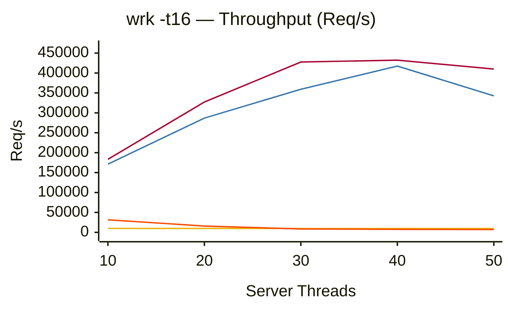

</td>
<td width="440">

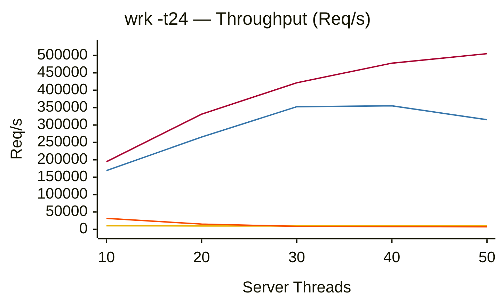

</td>
</tr>
<tr>
<td width="440">

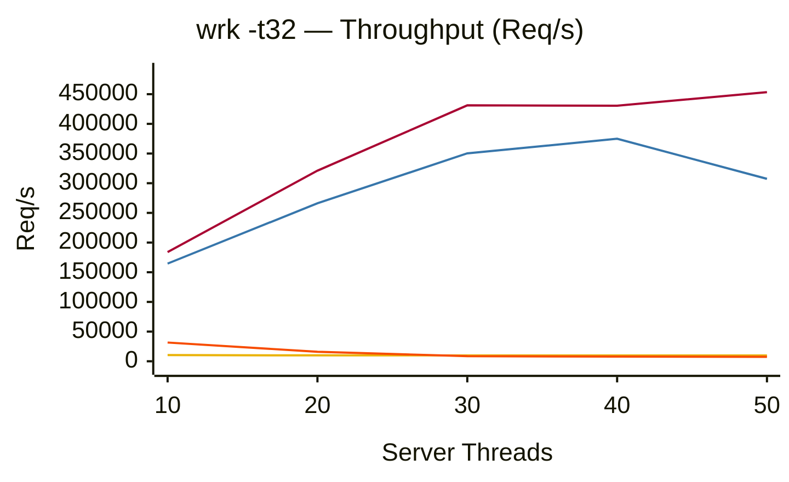

</td>
<td width="440">

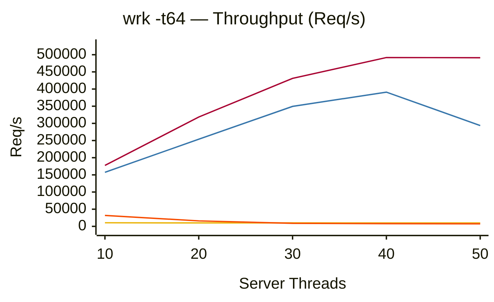

</td>
</tr>
</table>

**Legend:** 🟥 **EPython 0.1.0** · 🟦 **CPython 3.13.6t (FT)** · 🟨 **CPython 3.13.18 (GIL)** · 🟧 **RustPython 0.6.0**

<details>
<summary><strong>View detailed numbers — wrk -t16 (10, 20, 30, 40, 50 server threads)</strong></summary>

> **Note on `p99` at 30–50 server threads (`~400ms`):** Above ~`420k req/s`, `wrk -t16` saturates the load generator itself (`15.7 / 16` client threads pegged at `98%` CPU during the 40-thread run), stalling client event loops and inflating measured `p99` even while `p50` drops to `12–16ms`. Giving `wrk` enough threads (`-t24`, `-t32`, `-t64`) eliminates client saturation: `EPython` climbs to `505,087 req/s` and `p99` drops to `51–70ms`.

#### 10 server threads (`wrk -t16 -c10000 -d30s`)

| Interpreter | Req/s | Avg | p50 | p99 | Max | Steady CPU/req (user / sys / total) |
|---|--:|--:|--:|--:|--:|--:|
| **EPython 0.1.0** | **183,293** | **55.02ms** | **50.46ms** | **111.86ms** | **410.70ms** | **25.92 / 25.25 / 51.17 µs** |
| CPython 3.13.6t (FT) | 171,193 | 58.00ms | 54.64ms | 85.20ms | 170.67ms | 35.51 / 22.85 / 58.36 µs |
| RustPython 0.6.0 | 31,548 | 313.45ms | 310.02ms | 558.63ms | 676.07ms | 212.57 / 77.46 / 290.03 µs |
| CPython 3.13.18 (GIL) | 9,909 | 986.98ms | 974.89ms | 1.44s | 1.86s | 68.37 / 68.33 / 136.71 µs |

#### 20 server threads (`wrk -t16 -c10000 -d30s`)

| Interpreter | Req/s | Avg | p50 | p99 | Max | Steady CPU/req (user / sys / total) |
|---|--:|--:|--:|--:|--:|--:|
| **EPython 0.1.0** | **327,172** | **30.53ms** | **28.47ms** | **65.75ms** | **294.58ms** | **29.40 / 24.29 / 53.69 µs** |
| CPython 3.13.6t (FT) | 286,849 | 34.63ms | 33.56ms | 55.86ms | 140.98ms | 45.25 / 24.35 / 69.60 µs |
| RustPython 0.6.0 | 15,829 | 621.87ms | 625.85ms | 713.43ms | 1.15s | 402.02 / 375.15 / 777.17 µs |
| CPython 3.13.18 (GIL) | 9,726 | 1.01s | 991.63ms | 1.39s | 2.26s | 69.45 / 70.65 / 140.09 µs |

#### 30 server threads (`wrk -t16 -c10000 -d30s`)

| Interpreter | Req/s | Avg | p50 | p99 | Max | Steady CPU/req (user / sys / total) |
|---|--:|--:|--:|--:|--:|--:|
| **EPython 0.1.0** | **427,601** | **33.99ms** | **16.21ms** | **397.84ms** | **532.47ms** | **32.11 / 24.80 / 56.91 µs** |
| CPython 3.13.6t (FT) | 359,254 | 27.46ms | 26.35ms | 54.78ms | 119.59ms | 53.71 / 25.29 / 78.99 µs |
| CPython 3.13.18 (GIL) | 9,712 | 1.01s | 998.53ms | 1.44s | 2.13s | 68.69 / 71.78 / 140.46 µs |
| RustPython 0.6.0 | 8,500 | 1.15s | 1.15s | 1.35s | 2.54s | 554.07 / 733.87 / 1,287.93 µs |

#### 40 server threads (`wrk -t16 -c10000 -d30s`)

| Interpreter | Req/s | Avg | p50 | p99 | Max | Steady CPU/req (user / sys / total) |
|---|--:|--:|--:|--:|--:|--:|
| **EPython 0.1.0** | **432,361** | **45.67ms** | **12.93ms** | **419.68ms** | **532.17ms** | **30.57 / 25.60 / 56.18 µs** |
| CPython 3.13.6t (FT) | 417,353 | 25.43ms | 19.04ms | 306.35ms | 674.89ms | 66.26 / 26.60 / 92.85 µs |
| CPython 3.13.18 (GIL) | 9,656 | 1.01s | 1.00s | 1.43s | 2.42s | 69.38 / 72.49 / 141.87 µs |
| RustPython 0.6.0 | 7,597 | 1.28s | 1.29s | 1.52s | 2.76s | 616.71 / 816.06 / 1,432.77 µs |

#### 50 server threads (`wrk -t16 -c10000 -d30s`)

| Interpreter | Req/s | Avg | p50 | p99 | Max | Steady CPU/req (user / sys / total) |
|---|--:|--:|--:|--:|--:|--:|
| **EPython 0.1.0** | **409,928** | **45.82ms** | **12.09ms** | **403.49ms** | **537.23ms** | **31.52 / 26.47 / 57.99 µs** |
| CPython 3.13.6t (FT) | 342,737 | 45.69ms | 26.05ms | 779.68ms | 1.16s | 63.48 / 28.00 / 91.49 µs |
| CPython 3.13.18 (GIL) | 9,682 | 1.01s | 1.00s | 1.41s | 2.22s | 68.34 / 73.76 / 142.10 µs |
| RustPython 0.6.0 | 7,101 | 1.37s | 1.37s | 1.61s | 2.89s | 679.88 / 886.66 / 1,566.54 µs |

</details>

<details>
<summary><strong>View detailed numbers — wrk -t24 (10, 20, 30, 40, 50 server threads)</strong></summary>

#### 10 server threads (`wrk -t24 -c10000 -d30s`)

| Interpreter | Req/s | Avg | p50 | p99 | Max | Steady CPU/req (user / sys / total) |
|---|--:|--:|--:|--:|--:|--:|
| **EPython 0.1.0** | **194,391** | **51.80ms** | **49.52ms** | **79.11ms** | **352.88ms** | **24.71 / 24.46 / 49.17 µs** |
| CPython 3.13.6t (FT) | 168,933 | 59.00ms | 55.91ms | 87.15ms | 212.25ms | 35.85 / 23.29 / 59.14 µs |
| RustPython 0.6.0 | 31,543 | 313.74ms | 312.94ms | 373.34ms | 642.71ms | 208.63 / 79.76 / 288.39 µs |
| CPython 3.13.18 (GIL) | 10,398 | 943.42ms | 935.68ms | 1.25s | 1.67s | 63.11 / 66.52 / 129.63 µs |

#### 20 server threads (`wrk -t24 -c10000 -d30s`)

| Interpreter | Req/s | Avg | p50 | p99 | Max | Steady CPU/req (user / sys / total) |
|---|--:|--:|--:|--:|--:|--:|
| **EPython 0.1.0** | **331,119** | **30.43ms** | **29.35ms** | **54.56ms** | **257.79ms** | **30.79 / 25.64 / 56.43 µs** |
| CPython 3.13.6t (FT) | 265,390 | 37.45ms | 37.83ms | 58.92ms | 163.58ms | 48.19 / 27.07 / 75.26 µs |
| RustPython 0.6.0 | 15,186 | 648.28ms | 653.15ms | 741.30ms | 1.40s | 412.39 / 382.15 / 794.54 µs |
| CPython 3.13.18 (GIL) | 9,926 | 986.52ms | 979.45ms | 1.36s | 1.97s | 63.38 / 72.83 / 136.21 µs |

#### 30 server threads (`wrk -t24 -c10000 -d30s`)

| Interpreter | Req/s | Avg | p50 | p99 | Max | Steady CPU/req (user / sys / total) |
|---|--:|--:|--:|--:|--:|--:|
| **EPython 0.1.0** | **421,401** | **23.70ms** | **21.14ms** | **58.19ms** | **262.32ms** | **31.09 / 24.36 / 55.46 µs** |
| CPython 3.13.6t (FT) | 352,548 | 28.20ms | 27.72ms | 48.78ms | 134.94ms | 56.22 / 27.60 / 83.82 µs |
| CPython 3.13.18 (GIL) | 9,699 | 1.01s | 1.00s | 1.43s | 2.20s | 66.29 / 74.06 / 140.35 µs |
| RustPython 0.6.0 | 8,727 | 1.12s | 1.13s | 1.27s | 2.45s | 571.24 / 695.23 / 1,266.48 µs |

#### 40 server threads (`wrk -t24 -c10000 -d30s`)

| Interpreter | Req/s | Avg | p50 | p99 | Max | Steady CPU/req (user / sys / total) |
|---|--:|--:|--:|--:|--:|--:|
| **EPython 0.1.0** | **477,779** | **19.96ms** | **16.47ms** | **63.32ms** | **484.39ms** | **32.44 / 25.54 / 57.99 µs** |
| CPython 3.13.6t (FT) | 355,248 | 29.10ms | 25.83ms | 71.56ms | 369.34ms | 61.38 / 28.33 / 89.71 µs |
| CPython 3.13.18 (GIL) | 9,749 | 1.00s | 992.03ms | 1.49s | 2.40s | 66.42 / 73.64 / 140.05 µs |
| RustPython 0.6.0 | 7,794 | 1.25s | 1.26s | 1.44s | 2.80s | 614.01 / 775.45 / 1,389.45 µs |

#### 50 server threads (`wrk -t24 -c10000 -d30s`)

| Interpreter | Req/s | Avg | p50 | p99 | Max | Steady CPU/req (user / sys / total) |
|---|--:|--:|--:|--:|--:|--:|
| **EPython 0.1.0** | **505,087** | **18.38ms** | **13.39ms** | **107.89ms** | **416.27ms** | **34.44 / 27.05 / 61.49 µs** |
| CPython 3.13.6t (FT) | 315,231 | 42.42ms | 29.51ms | 573.72ms | 923.02ms | 60.48 / 30.07 / 90.54 µs |
| CPython 3.13.18 (GIL) | 9,694 | 1.01s | 998.65ms | 1.42s | 2.66s | 67.91 / 73.80 / 141.71 µs |
| RustPython 0.6.0 | 7,272 | 1.34s | 1.37s | 1.53s | 3.00s | 675.29 / 855.02 / 1,530.31 µs |

</details>

<details>
<summary><strong>View detailed numbers — wrk -t32 (10, 20, 30, 40, 50 server threads)</strong></summary>

#### 10 server threads (`wrk -t32 -c10000 -d30s`)

| Interpreter | Req/s | Avg | p50 | p99 | Max | Steady CPU/req (user / sys / total) |
|---|--:|--:|--:|--:|--:|--:|
| **EPython 0.1.0** | **184,046** | **55.39ms** | **52.86ms** | **93.30ms** | **424.55ms** | **25.84 / 25.72 / 51.56 µs** |
| CPython 3.13.6t (FT) | 164,565 | 60.53ms | 59.40ms | 86.63ms | 199.30ms | 37.01 / 23.73 / 60.74 µs |
| RustPython 0.6.0 | 31,577 | 313.75ms | 313.04ms | 381.79ms | 606.75ms | 206.94 / 81.48 / 288.42 µs |
| CPython 3.13.18 (GIL) | 10,449 | 937.97ms | 933.55ms | 1.26s | 1.88s | 62.17 / 67.03 / 129.20 µs |

#### 20 server threads (`wrk -t32 -c10000 -d30s`)

| Interpreter | Req/s | Avg | p50 | p99 | Max | Steady CPU/req (user / sys / total) |
|---|--:|--:|--:|--:|--:|--:|
| **EPython 0.1.0** | **321,100** | **31.70ms** | **30.17ms** | **55.67ms** | **346.59ms** | **30.92 / 27.07 / 57.99 µs** |
| CPython 3.13.6t (FT) | 266,210 | 37.54ms | 37.26ms | 56.29ms | 175.63ms | 48.00 / 27.01 / 75.00 µs |
| RustPython 0.6.0 | 15,961 | 617.92ms | 623.02ms | 703.32ms | 1.31s | 405.45 / 365.11 / 770.56 µs |
| CPython 3.13.18 (GIL) | 9,926 | 987.97ms | 979.20ms | 1.37s | 2.06s | 65.14 / 71.11 / 136.25 µs |

#### 30 server threads (`wrk -t32 -c10000 -d30s`)

| Interpreter | Req/s | Avg | p50 | p99 | Max | Steady CPU/req (user / sys / total) |
|---|--:|--:|--:|--:|--:|--:|
| **EPython 0.1.0** | **431,185** | **23.22ms** | **20.65ms** | **56.85ms** | **286.35ms** | **30.91 / 24.77 / 55.68 µs** |
| CPython 3.13.6t (FT) | 350,290 | 28.57ms | 27.74ms | 48.53ms | 201.65ms | 57.29 / 27.92 / 85.22 µs |
| CPython 3.13.18 (GIL) | 9,869 | 993.25ms | 987.78ms | 1.40s | 1.90s | 65.90 / 71.52 / 137.42 µs |
| RustPython 0.6.0 | 8,610 | 1.14s | 1.14s | 1.34s | 1.54s | 550.45 / 709.28 / 1,259.73 µs |

#### 40 server threads (`wrk -t32 -c10000 -d30s`)

| Interpreter | Req/s | Avg | p50 | p99 | Max | Steady CPU/req (user / sys / total) |
|---|--:|--:|--:|--:|--:|--:|
| **EPython 0.1.0** | **430,525** | **23.58ms** | **20.09ms** | **72.87ms** | **358.55ms** | **31.32 / 25.14 / 56.46 µs** |
| CPython 3.13.6t (FT) | 374,877 | 28.26ms | 24.04ms | 83.19ms | 429.28ms | 62.12 / 28.49 / 90.61 µs |
| CPython 3.13.18 (GIL) | 9,755 | 1.00s | 999.69ms | 1.45s | 2.05s | 68.21 / 71.76 / 139.97 µs |
| RustPython 0.6.0 | 7,934 | 1.23s | 1.24s | 1.43s | 2.55s | 606.16 / 768.38 / 1,374.54 µs |

#### 50 server threads (`wrk -t32 -c10000 -d30s`)

| Interpreter | Req/s | Avg | p50 | p99 | Max | Steady CPU/req (user / sys / total) |
|---|--:|--:|--:|--:|--:|--:|
| **EPython 0.1.0** | **453,398** | **22.19ms** | **18.94ms** | **69.08ms** | **318.15ms** | **33.75 / 26.34 / 60.08 µs** |
| CPython 3.13.6t (FT) | 307,368 | 43.58ms | 30.45ms | 590.30ms | 975.16ms | 57.45 / 30.64 / 88.08 µs |
| CPython 3.13.18 (GIL) | 9,731 | 1.01s | 995.37ms | 1.48s | 2.21s | 68.85 / 72.49 / 141.34 µs |
| RustPython 0.6.0 | 7,433 | 1.31s | 1.32s | 1.54s | 2.89s | 673.74 / 842.41 / 1,516.15 µs |

</details>

<details>
<summary><strong>View detailed numbers — wrk -t64 (10, 20, 30, 40, 50 server threads)</strong></summary>

#### 10 server threads (`wrk -t64 -c10000 -d30s`)

| Interpreter | Req/s | Avg | p50 | p99 | Max | Steady CPU/req (user / sys / total) |
|---|--:|--:|--:|--:|--:|--:|
| **EPython 0.1.0** | **177,588** | **56.96ms** | **54.97ms** | **82.06ms** | **416.57ms** | **26.94 / 26.65 / 53.60 µs** |
| CPython 3.13.6t (FT) | 157,480 | 63.42ms | 62.40ms | 88.07ms | 215.98ms | 38.17 / 25.27 / 63.44 µs |
| RustPython 0.6.0 | 31,792 | 312.58ms | 312.49ms | 380.98ms | 455.35ms | 206.18 / 79.80 / 285.99 µs |
| CPython 3.13.18 (GIL) | 10,479 | 938.83ms | 935.32ms | 1.25s | 1.64s | 63.10 / 65.45 / 128.55 µs |

#### 20 server threads (`wrk -t64 -c10000 -d30s`)

| Interpreter | Req/s | Avg | p50 | p99 | Max | Steady CPU/req (user / sys / total) |
|---|--:|--:|--:|--:|--:|--:|
| **EPython 0.1.0** | **318,483** | **32.13ms** | **30.36ms** | **55.02ms** | **395.81ms** | **30.50 / 27.65 / 58.14 µs** |
| CPython 3.13.6t (FT) | 253,820 | 39.33ms | 38.79ms | 58.09ms | 138.52ms | 49.07 / 29.62 / 78.68 µs |
| RustPython 0.6.0 | 15,965 | 619.12ms | 626.08ms | 727.42ms | 1.24s | 394.81 / 371.32 / 766.12 µs |
| CPython 3.13.18 (GIL) | 9,984 | 984.12ms | 976.93ms | 1.38s | 1.81s | 64.94 / 70.74 / 135.67 µs |

#### 30 server threads (`wrk -t64 -c10000 -d30s`)

| Interpreter | Req/s | Avg | p50 | p99 | Max | Steady CPU/req (user / sys / total) |
|---|--:|--:|--:|--:|--:|--:|
| **EPython 0.1.0** | **431,137** | **23.95ms** | **21.65ms** | **51.29ms** | **402.31ms** | **34.29 / 27.77 / 62.06 µs** |
| CPython 3.13.6t (FT) | 349,458 | 28.57ms | 27.93ms | 47.88ms | 134.36ms | 56.05 / 29.04 / 85.09 µs |
| CPython 3.13.18 (GIL) | 10,000 | 982.11ms | 973.83ms | 1.38s | 2.01s | 65.58 / 70.00 / 135.58 µs |
| RustPython 0.6.0 | 8,753 | 1.12s | 1.14s | 1.30s | 2.31s | 534.69 / 709.16 / 1,243.86 µs |

#### 40 server threads (`wrk -t64 -c10000 -d30s`)

| Interpreter | Req/s | Avg | p50 | p99 | Max | Steady CPU/req (user / sys / total) |
|---|--:|--:|--:|--:|--:|--:|
| **EPython 0.1.0** | **491,831** | **21.61ms** | **17.68ms** | **65.81ms** | **448.95ms** | **34.54 / 28.12 / 62.67 µs** |
| CPython 3.13.6t (FT) | 391,047 | 27.04ms | 23.61ms | 70.06ms | 450.60ms | 65.18 / 29.04 / 94.23 µs |
| CPython 3.13.18 (GIL) | 9,785 | 1.00s | 996.57ms | 1.40s | 2.26s | 69.67 / 70.09 / 139.76 µs |
| RustPython 0.6.0 | 7,760 | 1.26s | 1.27s | 1.46s | 2.68s | 606.11 / 793.54 / 1,399.64 µs |

#### 50 server threads (`wrk -t64 -c10000 -d30s`)

| Interpreter | Req/s | Avg | p50 | p99 | Max | Steady CPU/req (user / sys / total) |
|---|--:|--:|--:|--:|--:|--:|
| **EPython 0.1.0** | **491,233** | **21.55ms** | **17.43ms** | **70.60ms** | **441.48ms** | **36.31 / 28.99 / 65.30 µs** |
| CPython 3.13.6t (FT) | 293,681 | 48.29ms | 31.88ms | 696.03ms | 1.12s | 57.80 / 32.10 / 89.90 µs |
| CPython 3.13.18 (GIL) | 9,909 | 990.94ms | 984.06ms | 1.41s | 2.21s | 66.73 / 71.78 / 138.51 µs |
| RustPython 0.6.0 | 7,422 | 1.32s | 1.33s | 1.59s | 2.67s | 658.80 / 855.62 / 1,514.42 µs |

</details>

### Reproduce

**macOS:**

```sh
brew install wrk
sudo sysctl -w kern.ipc.somaxconn=16384
```

**Linux:**

```sh
sudo apt install wrk
sudo sysctl -w fs.file-max=2000000 net.core.somaxconn=65535 net.ipv4.tcp_max_syn_backlog=65535
sudo sysctl -w net.ipv4.ip_local_port_range="1024 65535" net.ipv4.tcp_tw_reuse=1
sudo sysctl -w kernel.threads-max=4194304 kernel.pid_max=4194304 vm.max_map_count=1048576
```

**Run:**

```sh
# terminal 1 — server ([port=8000] [num_threads=cpu_count])
ulimit -n 65536 && epython threaded_server.py 8000 50

# terminal 2 — load generator (no "Socket errors:" line = 0 errors across all 10k connections)
ulimit -n 65536 && wrk -t24 -c10000 -d30s --timeout 5s --latency -s post.lua http://127.0.0.1:8000/items
```

---

## C10K Multiprocess I/O Benchmark

Unmodified [`multiprocess_server.py`](multiprocess_server.py) + [`post.lua`](post.lua) at **10,000 concurrent keep-alive connections (`wrk -c10000`)** with **zero CLI flags** (`selectors` + `SO_REUSEPORT` `multiprocessing.Process` workers parsing JSON, FNV-1a hashing, updating a per-worker 64-shard dict, and returning JSON).

80 sequential 30s runs (`10–50` workers × `wrk -t16/-t24/-t32/-t64`, **0 errors**): `EPython 0.1.0` wins throughput in **17 / 20** configs (sweeping `-t32` and `-t64` 5/5) and CPU/req in **18 / 20** — peaking at **631,105 req/s** (`+4.7%` vs. CPython GIL, `+6.5%` vs. CPython FT, `2.64×` RustPython) and **587,823 req/s** at `-t64`, 50w (`+7.9%` vs. GIL, `15.7%` lower CPU/req).

<details>
<summary><strong>View summary table</strong></summary>

| Interpreter | Peak Req/s | `wrk -t32`, 50w (`p50`) | `wrk -t64`, 50w (`p99`) | CPU/req (`t64`, 50w) | Memory (`t64`, 50w `PSS` / `RSS`) |
|---|--:|--:|--:|--:|--:|
| **EPython 0.1.0** | **631,105** (`t32`, 50w) | **631,105** (`10.68ms`) | **587,823** (`75.36ms`) | **53.55 µs** | 2,343 / 2,367 MiB (2p) |
| CPython 3.13.6t (FT) | 592,541 (`t32`, 50w) | 592,541 (`10.69ms`) | 544,376 (`63.96ms`) | 65.88 µs | 433 / 1,272 MiB (51p) |
| CPython 3.13.18 (GIL) | 602,773 (`t32`, 50w) | 602,773 (`10.36ms`) | 544,844 (`63.96ms`) | 63.50 µs | 228 / 716 MiB (51p) |
| RustPython 0.6.0 | 265,444 (`t16`, 50w) | 238,967 (`38.96ms`) | 241,131 (`84.25ms`) | 191.59 µs | 603 / 3,083 MiB (53p) |

</details>

<table>
<tr>
<td width="440">

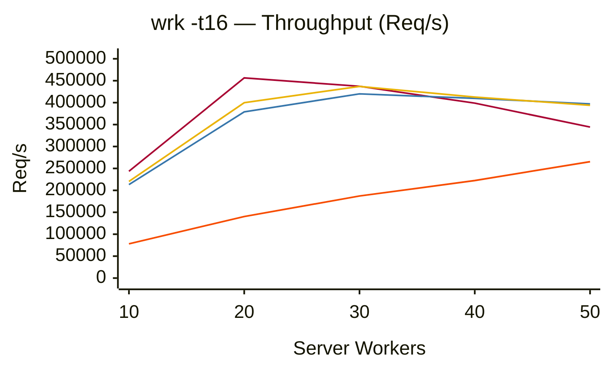

</td>
<td width="440">

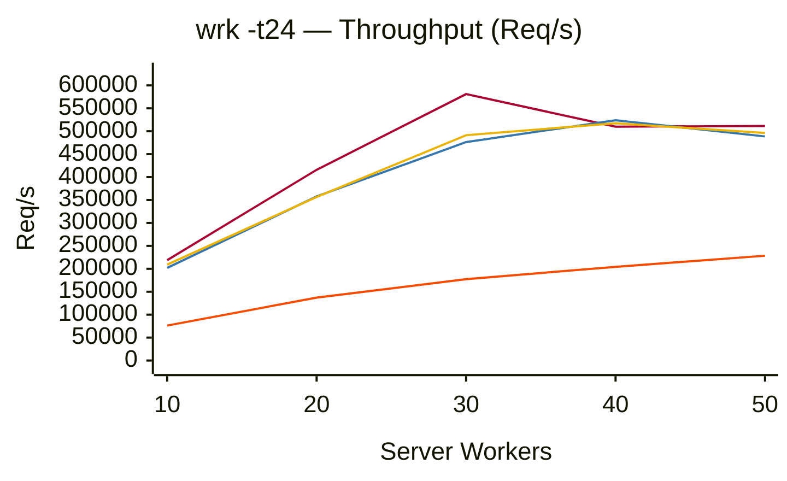

</td>
</tr>
<tr>
<td width="440">

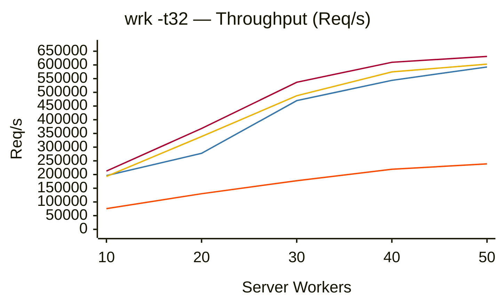

</td>
<td width="440">

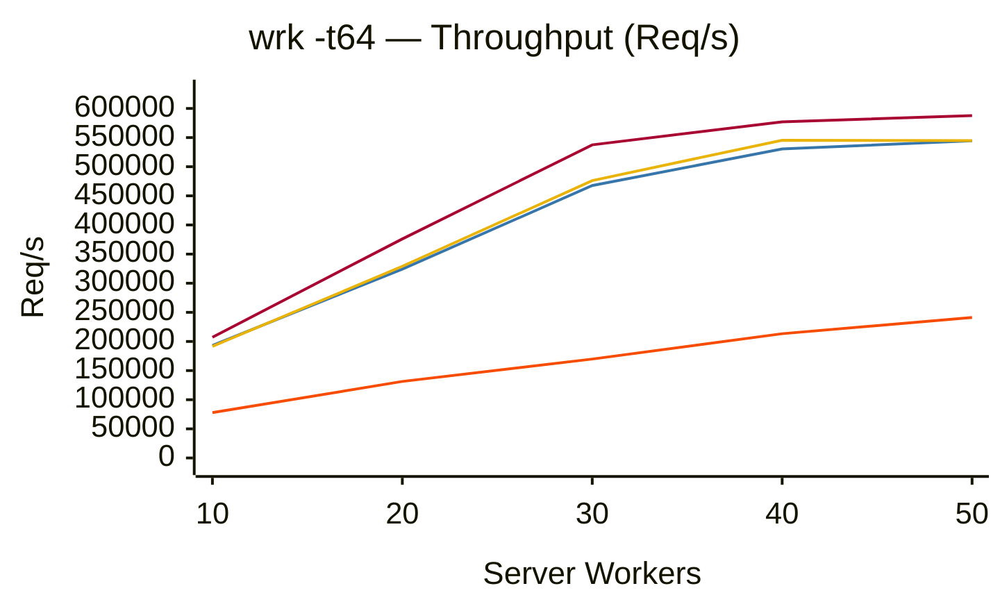

</td>
</tr>
</table>

**Legend:** 🟥 **EPython 0.1.0** · 🟦 **CPython 3.13.6t (FT)** · 🟨 **CPython 3.13.18 (GIL)** · 🟧 **RustPython 0.6.0**

<details>
<summary><strong>View detailed numbers — wrk -t16 (10, 20, 30, 40, 50 server workers)</strong></summary>

> **Note on `wrk -t16` at 30–50 workers:** Above ~`430–456k req/s`, `wrk -t16` pegs all 16 client threads (`15.5–16.0 / 16` cores), throttling throughput and inflating tail latency. Increasing `wrk` threads (`-t24`, `-t32`, `-t64`) removes client saturation and lets `EPython` scale to **`631,105 req/s`**.

#### 10 server workers (`wrk -t16 -c10000 -d30s`)

| Interpreter | Req/s | Avg | p50 | p99 | Max | Steady CPU/req (user / sys / total) | Memory (`PSS` / `RSS`) |
|---|--:|--:|--:|--:|--:|--:|--:|
| **EPython 0.1.0** | **243,466** | **41.40ms** | **38.37ms** | **73.26ms** | **327.90ms** | **20.96 / 22.19 / 43.15 µs** | 655 / 679 MiB (2p) |
| CPython 3.13.18 (GIL) | 220,266 | 45.05ms | 41.92ms | 73.57ms | 145.59ms | 22.78 / 22.62 / 45.40 µs | 77 / 160 MiB (11p) |
| CPython 3.13.6t (FT) | 213,103 | 46.59ms | 43.01ms | 78.63ms | 155.83ms | 25.05 / 21.86 / 46.91 µs | 103 / 268 MiB (11p) |
| RustPython 0.6.0 | 78,074 | 127.01ms | 122.11ms | 173.21ms | 304.96ms | 98.17 / 29.89 / 128.06 µs | 260 / 785 MiB (13p) |

#### 20 server workers (`wrk -t16 -c10000 -d30s`)

| Interpreter | Req/s | Avg | p50 | p99 | Max | Steady CPU/req (user / sys / total) | Memory (`PSS` / `RSS`) |
|---|--:|--:|--:|--:|--:|--:|--:|
| **EPython 0.1.0** | **456,372** | **20.22ms** | **17.94ms** | **52.97ms** | **308.00ms** | **22.68 / 22.28 / 44.95 µs** | 621 / 645 MiB (2p) |
| CPython 3.13.18 (GIL) | 399,916 | 24.32ms | 23.68ms | 53.43ms | 92.78ms | 27.62 / 22.06 / 49.68 µs | 100 / 299 MiB (21p) |
| CPython 3.13.6t (FT) | 378,935 | 26.01ms | 25.13ms | 54.14ms | 110.15ms | 30.14 / 22.03 / 52.17 µs | 182 / 524 MiB (21p) |
| RustPython 0.6.0 | 140,331 | 70.69ms | 69.40ms | 104.89ms | 205.58ms | 112.04 / 30.45 / 142.49 µs | 339 / 1,344 MiB (23p) |

#### 30 server workers (`wrk -t16 -c10000 -d30s`)

| Interpreter | Req/s | Avg | p50 | p99 | Max | Steady CPU/req (user / sys / total) | Memory (`PSS` / `RSS`) |
|---|--:|--:|--:|--:|--:|--:|--:|
| **EPython 0.1.0** | **437,313** | **24.12ms** | **10.16ms** | **255.69ms** | **528.12ms** | **27.36 / 25.53 / 52.89 µs** | 852 / 876 MiB (2p) |
| CPython 3.13.18 (GIL) | 436,921 | 11.76ms | 11.44ms | 29.00ms | 76.88ms | 35.93 / 25.33 / 61.26 µs | 142 / 439 MiB (31p) |
| CPython 3.13.6t (FT) | 420,010 | 12.61ms | 11.48ms | 31.50ms | 61.38ms | 38.92 / 24.77 / 63.69 µs | 270 / 769 MiB (31p) |
| RustPython 0.6.0 | 187,170 | 52.91ms | 52.22ms | 82.88ms | 171.53ms | 127.77 / 31.75 / 159.52 µs | 439 / 1,938 MiB (33p) |

#### 40 server workers (`wrk -t16 -c10000 -d30s`)

| Interpreter | Req/s | Avg | p50 | p99 | Max | Steady CPU/req (user / sys / total) | Memory (`PSS` / `RSS`) |
|---|--:|--:|--:|--:|--:|--:|--:|
| CPython 3.13.18 (GIL) | 412,747 | 12.16ms | 11.72ms | 27.37ms | 83.52ms | 40.87 / 27.67 / 68.54 µs | 183 / 577 MiB (41p) |
| CPython 3.13.6t (FT) | 409,754 | 12.31ms | 11.75ms | 29.28ms | 77.41ms | 44.54 / 26.51 / 71.06 µs | 355 / 1,020 MiB (41p) |
| **EPython 0.1.0** | **398,860** | **78.24ms** | **12.70ms** | **480.50ms** | **552.29ms** | **23.47 / 23.20 / 46.67 µs** | 1,024 / 1,048 MiB (2p) |
| RustPython 0.6.0 | 222,304 | 44.21ms | 42.04ms | 89.61ms | 170.62ms | 135.53 / 33.78 / 169.31 µs | 527 / 2,490 MiB (43p) |

#### 50 server workers (`wrk -t16 -c10000 -d30s`)

| Interpreter | Req/s | Avg | p50 | p99 | Max | Steady CPU/req (user / sys / total) | Memory (`PSS` / `RSS`) |
|---|--:|--:|--:|--:|--:|--:|--:|
| CPython 3.13.6t (FT) | 397,059 | 12.71ms | 12.06ms | 29.93ms | 62.87ms | 47.98 / 28.32 / 76.30 µs | 435 / 1,268 MiB (51p) |
| CPython 3.13.18 (GIL) | 394,022 | 12.75ms | 12.29ms | 28.39ms | 62.85ms | 44.26 / 29.76 / 74.02 µs | 225 / 722 MiB (51p) |
| **EPython 0.1.0** | **344,376** | **72.06ms** | **11.48ms** | **452.94ms** | **574.89ms** | **23.02 / 22.82 / 45.84 µs** | 1,150 / 1,174 MiB (2p) |
| RustPython 0.6.0 | 265,444 | 35.46ms | 31.55ms | 83.20ms | 261.77ms | 142.01 / 33.68 / 175.69 µs | 628 / 3,089 MiB (53p) |

</details>

<details>
<summary><strong>View detailed numbers — wrk -t24 (10, 20, 30, 40, 50 server workers)</strong></summary>

#### 10 server workers (`wrk -t24 -c10000 -d30s`)

| Interpreter | Req/s | Avg | p50 | p99 | Max | Steady CPU/req (user / sys / total) | Memory (`PSS` / `RSS`) |
|---|--:|--:|--:|--:|--:|--:|--:|
| **EPython 0.1.0** | **218,906** | **45.97ms** | **44.19ms** | **74.32ms** | **306.93ms** | **24.20 / 25.17 / 49.37 µs** | 640 / 665 MiB (2p) |
| CPython 3.13.18 (GIL) | 209,158 | 47.56ms | 44.04ms | 75.82ms | 135.16ms | 23.88 / 23.91 / 47.79 µs | 77 / 160 MiB (11p) |
| CPython 3.13.6t (FT) | 201,953 | 49.23ms | 46.04ms | 79.20ms | 139.10ms | 26.44 / 23.06 / 49.50 µs | 104 / 270 MiB (11p) |
| RustPython 0.6.0 | 76,270 | 130.33ms | 126.54ms | 176.03ms | 310.70ms | 99.51 / 31.57 / 131.08 µs | 262 / 787 MiB (13p) |

#### 20 server workers (`wrk -t24 -c10000 -d30s`)

| Interpreter | Req/s | Avg | p50 | p99 | Max | Steady CPU/req (user / sys / total) | Memory (`PSS` / `RSS`) |
|---|--:|--:|--:|--:|--:|--:|--:|
| **EPython 0.1.0** | **415,900** | **25.22ms** | **23.37ms** | **55.46ms** | **369.44ms** | **23.99 / 24.80 / 48.79 µs** | 654 / 678 MiB (2p) |
| CPython 3.13.6t (FT) | 357,756 | 27.76ms | 28.21ms | 52.12ms | 102.88ms | 31.97 / 23.92 / 55.89 µs | 184 / 526 MiB (21p) |
| CPython 3.13.18 (GIL) | 356,697 | 27.82ms | 28.24ms | 51.94ms | 109.30ms | 31.26 / 24.79 / 56.05 µs | 100 / 299 MiB (21p) |
| RustPython 0.6.0 | 137,148 | 72.46ms | 72.08ms | 102.25ms | 208.43ms | 114.28 / 31.46 / 145.74 µs | 338 / 1,340 MiB (23p) |

#### 30 server workers (`wrk -t24 -c10000 -d30s`)

| Interpreter | Req/s | Avg | p50 | p99 | Max | Steady CPU/req (user / sys / total) | Memory (`PSS` / `RSS`) |
|---|--:|--:|--:|--:|--:|--:|--:|
| **EPython 0.1.0** | **581,030** | **19.00ms** | **14.23ms** | **123.93ms** | **518.40ms** | **24.92 / 24.84 / 49.76 µs** | 847 / 871 MiB (2p) |
| CPython 3.13.18 (GIL) | 491,311 | 19.74ms | 18.16ms | 45.39ms | 96.79ms | 32.08 / 24.26 / 56.34 µs | 142 / 439 MiB (31p) |
| CPython 3.13.6t (FT) | 476,378 | 20.43ms | 18.89ms | 45.99ms | 91.02ms | 34.40 / 23.80 / 58.20 µs | 268 / 769 MiB (31p) |
| RustPython 0.6.0 | 177,443 | 55.91ms | 54.69ms | 85.42ms | 189.50ms | 135.18 / 33.66 / 168.84 µs | 439 / 1,919 MiB (33p) |

#### 40 server workers (`wrk -t24 -c10000 -d30s`)

| Interpreter | Req/s | Avg | p50 | p99 | Max | Steady CPU/req (user / sys / total) | Memory (`PSS` / `RSS`) |
|---|--:|--:|--:|--:|--:|--:|--:|
| CPython 3.13.6t (FT) | 524,029 | 12.15ms | 10.17ms | 35.62ms | 109.96ms | 41.03 / 26.11 / 67.14 µs | 354 / 1,022 MiB (41p) |
| CPython 3.13.18 (GIL) | 517,458 | 11.43ms | 9.28ms | 33.50ms | 130.42ms | 36.58 / 25.97 / 62.55 µs | 186 / 579 MiB (41p) |
| **EPython 0.1.0** | **510,047** | **58.68ms** | **13.44ms** | **484.77ms** | **550.89ms** | **25.96 / 24.83 / 50.79 µs** | 1,387 / 1,412 MiB (2p) |
| RustPython 0.6.0 | 204,323 | 48.45ms | 46.34ms | 89.91ms | 261.05ms | 149.18 / 35.91 / 185.09 µs | 526 / 2,495 MiB (43p) |

#### 50 server workers (`wrk -t24 -c10000 -d30s`)

| Interpreter | Req/s | Avg | p50 | p99 | Max | Steady CPU/req (user / sys / total) | Memory (`PSS` / `RSS`) |
|---|--:|--:|--:|--:|--:|--:|--:|
| **EPython 0.1.0** | **511,514** | **79.70ms** | **11.49ms** | **496.82ms** | **559.28ms** | **24.71 / 24.10 / 48.81 µs** | 1,202 / 1,226 MiB (2p) |
| CPython 3.13.18 (GIL) | 496,178 | 11.53ms | 9.23ms | 33.68ms | 89.00ms | 38.87 / 27.04 / 65.91 µs | 228 / 717 MiB (51p) |
| CPython 3.13.6t (FT) | 488,689 | 11.94ms | 9.80ms | 35.09ms | 95.21ms | 41.85 / 25.69 / 67.53 µs | 435 / 1,270 MiB (51p) |
| RustPython 0.6.0 | 228,520 | 43.00ms | 39.94ms | 95.28ms | 288.80ms | 152.12 / 36.07 / 188.20 µs | 623 / 3,052 MiB (53p) |

</details>

<details>
<summary><strong>View detailed numbers — wrk -t32 (10, 20, 30, 40, 50 server workers)</strong></summary>

#### 10 server workers (`wrk -t32 -c10000 -d30s`)

| Interpreter | Req/s | Avg | p50 | p99 | Max | Steady CPU/req (user / sys / total) | Memory (`PSS` / `RSS`) |
|---|--:|--:|--:|--:|--:|--:|--:|
| **EPython 0.1.0** | **212,684** | **47.33ms** | **45.92ms** | **75.22ms** | **336.33ms** | **24.62 / 25.57 / 50.19 µs** | 680 / 704 MiB (2p) |
| CPython 3.13.6t (FT) | 196,113 | 50.76ms | 49.33ms | 79.72ms | 156.68ms | 28.27 / 22.70 / 50.97 µs | 104 / 273 MiB (11p) |
| CPython 3.13.18 (GIL) | 193,126 | 51.50ms | 50.74ms | 79.82ms | 138.67ms | 27.34 / 24.40 / 51.74 µs | 77 / 160 MiB (11p) |
| RustPython 0.6.0 | 75,537 | 131.58ms | 129.39ms | 178.64ms | 387.24ms | 101.13 / 31.22 / 132.36 µs | 262 / 787 MiB (13p) |

#### 20 server workers (`wrk -t32 -c10000 -d30s`)

| Interpreter | Req/s | Avg | p50 | p99 | Max | Steady CPU/req (user / sys / total) | Memory (`PSS` / `RSS`) |
|---|--:|--:|--:|--:|--:|--:|--:|
| **EPython 0.1.0** | **368,002** | **28.29ms** | **25.68ms** | **59.84ms** | **375.43ms** | **27.61 / 27.87 / 55.49 µs** | 751 / 776 MiB (2p) |
| CPython 3.13.18 (GIL) | 338,766 | 29.36ms | 29.12ms | 53.54ms | 102.71ms | 33.00 / 25.99 / 59.00 µs | 101 / 300 MiB (21p) |
| CPython 3.13.6t (FT) | 277,378 | 35.96ms | 33.41ms | 66.87ms | 152.26ms | 42.84 / 29.21 / 72.05 µs | 183 / 524 MiB (21p) |
| RustPython 0.6.0 | 130,057 | 76.46ms | 75.16ms | 106.57ms | 203.57ms | 121.16 / 32.55 / 153.70 µs | 334 / 1,344 MiB (23p) |

#### 30 server workers (`wrk -t32 -c10000 -d30s`)

| Interpreter | Req/s | Avg | p50 | p99 | Max | Steady CPU/req (user / sys / total) | Memory (`PSS` / `RSS`) |
|---|--:|--:|--:|--:|--:|--:|--:|
| **EPython 0.1.0** | **536,696** | **19.69ms** | **16.41ms** | **55.76ms** | **436.38ms** | **25.45 / 25.61 / 51.06 µs** | 933 / 957 MiB (2p) |
| CPython 3.13.18 (GIL) | 487,409 | 20.23ms | 19.14ms | 43.07ms | 117.07ms | 34.33 / 25.43 / 59.76 µs | 143 / 441 MiB (31p) |
| CPython 3.13.6t (FT) | 469,672 | 21.05ms | 20.11ms | 43.52ms | 101.04ms | 37.52 / 25.13 / 62.65 µs | 270 / 771 MiB (31p) |
| RustPython 0.6.0 | 177,515 | 56.00ms | 54.67ms | 81.51ms | 164.93ms | 134.66 / 34.26 / 168.92 µs | 441 / 1,909 MiB (33p) |

#### 40 server workers (`wrk -t32 -c10000 -d30s`)

| Interpreter | Req/s | Avg | p50 | p99 | Max | Steady CPU/req (user / sys / total) | Memory (`PSS` / `RSS`) |
|---|--:|--:|--:|--:|--:|--:|--:|
| **EPython 0.1.0** | **609,679** | **17.28ms** | **13.56ms** | **71.47ms** | **488.57ms** | **26.38 / 25.67 / 52.05 µs** | 1,194 / 1,218 MiB (2p) |
| CPython 3.13.18 (GIL) | 574,578 | 16.28ms | 14.28ms | 44.53ms | 243.53ms | 35.01 / 24.77 / 59.78 µs | 186 / 577 MiB (41p) |
| CPython 3.13.6t (FT) | 543,713 | 17.26ms | 15.35ms | 46.83ms | 112.71ms | 38.14 / 24.94 / 63.08 µs | 353 / 1,022 MiB (41p) |
| RustPython 0.6.0 | 219,244 | 45.27ms | 43.76ms | 77.72ms | 175.67ms | 142.81 / 36.42 / 179.23 µs | 524 / 2,496 MiB (43p) |

#### 50 server workers (`wrk -t32 -c10000 -d30s`)

| Interpreter | Req/s | Avg | p50 | p99 | Max | Steady CPU/req (user / sys / total) | Memory (`PSS` / `RSS`) |
|---|--:|--:|--:|--:|--:|--:|--:|
| **EPython 0.1.0** | **631,105** | **18.97ms** | **10.68ms** | **296.61ms** | **650.11ms** | **27.36 / 26.30 / 53.67 µs** | 2,302 / 2,326 MiB (2p) |
| CPython 3.13.18 (GIL) | 602,773 | 13.94ms | 10.36ms | 50.61ms | 136.10ms | 35.63 / 25.68 / 61.31 µs | 229 / 719 MiB (51p) |
| CPython 3.13.6t (FT) | 592,541 | 14.40ms | 10.69ms | 52.29ms | 242.00ms | 38.15 / 24.61 / 62.77 µs | 433 / 1,271 MiB (51p) |
| RustPython 0.6.0 | 238,967 | 41.39ms | 38.96ms | 85.67ms | 257.57ms | 146.35 / 36.89 / 183.24 µs | 624 / 3,069 MiB (53p) |

</details>

<details>
<summary><strong>View detailed numbers — wrk -t64 (10, 20, 30, 40, 50 server workers)</strong></summary>

#### 10 server workers (`wrk -t64 -c10000 -d30s`)

| Interpreter | Req/s | Avg | p50 | p99 | Max | Steady CPU/req (user / sys / total) | Memory (`PSS` / `RSS`) |
|---|--:|--:|--:|--:|--:|--:|--:|
| **EPython 0.1.0** | **207,283** | **48.69ms** | **46.56ms** | **74.61ms** | **387.04ms** | **25.28 / 26.79 / 52.07 µs** | 671 / 696 MiB (2p) |
| CPython 3.13.6t (FT) | 193,240 | 51.66ms | 50.39ms | 78.13ms | 134.88ms | 27.84 / 23.87 / 51.71 µs | 105 / 270 MiB (11p) |
| CPython 3.13.18 (GIL) | 191,644 | 52.08ms | 51.05ms | 77.63ms | 144.65ms | 27.02 / 25.14 / 52.16 µs | 77 / 159 MiB (11p) |
| RustPython 0.6.0 | 77,835 | 128.18ms | 123.41ms | 181.60ms | 343.01ms | 99.14 / 29.32 / 128.46 µs | 262 / 788 MiB (13p) |

#### 20 server workers (`wrk -t64 -c10000 -d30s`)

| Interpreter | Req/s | Avg | p50 | p99 | Max | Steady CPU/req (user / sys / total) | Memory (`PSS` / `RSS`) |
|---|--:|--:|--:|--:|--:|--:|--:|
| **EPython 0.1.0** | **376,017** | **27.52ms** | **25.63ms** | **51.87ms** | **415.93ms** | **26.55 / 27.68 / 54.23 µs** | 673 / 697 MiB (2p) |
| CPython 3.13.18 (GIL) | 329,028 | 30.34ms | 29.54ms | 54.01ms | 126.35ms | 33.41 / 27.33 / 60.75 µs | 101 / 299 MiB (21p) |
| CPython 3.13.6t (FT) | 324,161 | 30.80ms | 29.89ms | 54.76ms | 105.21ms | 35.10 / 26.55 / 61.66 µs | 183 / 520 MiB (21p) |
| RustPython 0.6.0 | 131,369 | 75.98ms | 73.93ms | 106.37ms | 220.50ms | 118.87 / 33.29 / 152.16 µs | 336 / 1,343 MiB (23p) |

#### 30 server workers (`wrk -t64 -c10000 -d30s`)

| Interpreter | Req/s | Avg | p50 | p99 | Max | Steady CPU/req (user / sys / total) | Memory (`PSS` / `RSS`) |
|---|--:|--:|--:|--:|--:|--:|--:|
| **EPython 0.1.0** | **537,503** | **20.21ms** | **17.10ms** | **57.37ms** | **506.72ms** | **26.33 / 27.48 / 53.80 µs** | 795 / 819 MiB (2p) |
| CPython 3.13.18 (GIL) | 476,169 | 20.94ms | 20.13ms | 42.68ms | 110.81ms | 35.38 / 26.72 / 62.10 µs | 142 / 437 MiB (31p) |
| CPython 3.13.6t (FT) | 467,626 | 21.36ms | 20.55ms | 45.06ms | 127.58ms | 37.53 / 25.89 / 63.42 µs | 266 / 768 MiB (31p) |
| RustPython 0.6.0 | 169,826 | 58.77ms | 57.81ms | 89.68ms | 194.90ms | 140.70 / 35.80 / 176.50 µs | 431 / 1,902 MiB (33p) |

#### 40 server workers (`wrk -t64 -c10000 -d30s`)

| Interpreter | Req/s | Avg | p50 | p99 | Max | Steady CPU/req (user / sys / total) | Memory (`PSS` / `RSS`) |
|---|--:|--:|--:|--:|--:|--:|--:|
| **EPython 0.1.0** | **577,080** | **18.19ms** | **14.62ms** | **59.24ms** | **469.40ms** | **27.90 / 27.34 / 55.24 µs** | 1,882 / 1,906 MiB (2p) |
| CPython 3.13.18 (GIL) | 545,481 | 18.35ms | 15.21ms | 56.15ms | 184.40ms | 36.12 / 26.49 / 62.61 µs | 184 / 579 MiB (41p) |
| CPython 3.13.6t (FT) | 530,531 | 18.83ms | 15.73ms | 56.21ms | 182.50ms | 40.77 / 26.33 / 67.10 µs | 352 / 1,022 MiB (41p) |
| RustPython 0.6.0 | 213,312 | 46.83ms | 45.46ms | 77.80ms | 193.07ms | 147.72 / 37.49 / 185.21 µs | 524 / 2,482 MiB (43p) |

#### 50 server workers (`wrk -t64 -c10000 -d30s`)

| Interpreter | Req/s | Avg | p50 | p99 | Max | Steady CPU/req (user / sys / total) | Memory (`PSS` / `RSS`) |
|---|--:|--:|--:|--:|--:|--:|--:|
| **EPython 0.1.0** | **587,823** | **18.16ms** | **13.75ms** | **75.36ms** | **552.09ms** | **27.43 / 26.12 / 53.55 µs** | 2,343 / 2,367 MiB (2p) |
| CPython 3.13.18 (GIL) | 544,844 | 18.25ms | 14.77ms | 63.96ms | 200.93ms | 37.20 / 26.29 / 63.50 µs | 228 / 716 MiB (51p) |
| CPython 3.13.6t (FT) | 544,376 | 18.37ms | 14.95ms | 63.96ms | 188.88ms | 39.82 / 26.06 / 65.88 µs | 433 / 1,272 MiB (51p) |
| RustPython 0.6.0 | 241,131 | 41.49ms | 38.40ms | 84.25ms | 270.73ms | 152.77 / 38.82 / 191.59 µs | 603 / 3,083 MiB (53p) |

</details>

### Reproduce

```sh
# terminal 1 — server ([port=8000] [num_workers=cpu_count])
ulimit -n 65536 && epython multiprocess_server.py 8000 50

# terminal 2 — load generator (no "Socket errors:" line = 0 errors across all 10k connections)
ulimit -n 65536 && wrk -t32 -c10000 -d30s --timeout 5s --latency -s post.lua http://127.0.0.1:8000/items
```

---

## Multithreaded `pyperformance` Highlights

Selected `pyperformance 1.14.0` benchmarks at **8 threads** (time/op, lower is faster) where `EPython` leads. CPython remains faster on single-threaded and CPU-bound pure-Python compute.

<table>
<tr>
<td width="440">

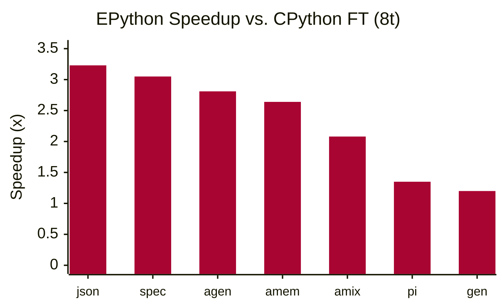

</td>
<td width="440">

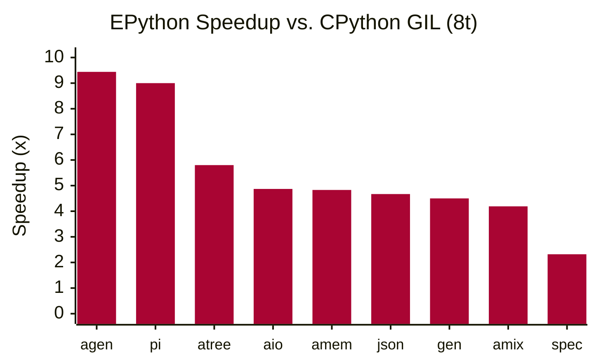

</td>
</tr>
</table>

| Benchmark (`8` threads, lower is faster) | **EPython 0.1.0** | CPython 3.13.6t (FT) | CPython 3.13.18 (GIL) | RustPython 0.6.0 | EPython vs. FT | EPython vs. GIL |
|---|--:|--:|--:|--:|--:|--:|
| `json_dumps` | **2.06ms** | 6.67ms | 9.63ms | 42.51ms | **3.23× faster** | **4.67× faster** |
| `spectral_norm` | **44.14ms** | 134.67ms | 102.45ms | 620.55ms | **3.05× faster** | **2.32× faster** |
| `async_generators`¹ | **53.22ms** | 149.57ms | 502.23ms | timeout | **2.81× faster** | **9.44× faster** |
| `async_tree_memoization` | **196.67ms** | 519.22ms | 949.99ms | 1.72s | **2.64× faster** | **4.83× faster** |
| `async_tree_cpu_io_mixed` | **256.97ms** | 534.55ms | 1.08s | 1.72s | **2.08× faster** | **4.19× faster** |
| `async_tree` | **141.73ms** | `RuntimeError`² | 821.96ms | 1.56s | — | **5.80× faster** |
| `async_tree_io` | **312.42ms** | `RuntimeError`² | 1.52s | timeout | — | **4.87× faster** |
| `pidigits` | **21.70ms** | 29.30ms | 195.37ms | 25.85ms | **1.35× faster** | **9.00× faster** |
| `generators` | **50.10ms** | 60.02ms | 225.49ms | 654.94ms | **1.20× faster** | **4.50× faster** |

> ¹ `EPython` also leads single-threaded (`1t`) on `async_generators` (`229.63ms` vs. `361.40ms` GIL / `409.76ms` FT) and `coroutines` (`14.69ms` vs. `22.38ms` GIL / `25.05ms` FT).
> ² `CPython 3.13.6t (FT)` raised `RuntimeError: Set changed size during iteration` when running 8 concurrent `asyncio` event loops.

---

## Test Machine

| Spec | Value |
|---|---|
| **CPU** | AMD EPYC 7B13 (64 vCPUs — 32 cores / 64 threads, x86_64) |
| **Cache** | 1 MiB L1d, 1 MiB L1i, 16 MiB L2, 128 MiB L3 |
| **Memory** | 117 GiB RAM |
| **OS / Kernel** | Debian GNU/Linux, Linux 7.1.6 (`x86_64`, `SMP PREEMPT_DYNAMIC`) |
| **Topology** | Server and `wrk` co-located on the same host over loopback (`127.0.0.1`) |
| **Runtimes** | `EPython 0.1.0` (Erlang/OTP 29, ERTS 17.0.4), `CPython 3.13.18`, `CPython 3.13.6t` (free-threaded), `RustPython 0.6.0` (`rustc 1.100.0`) |
| **WSGI Stack** | `Django 6.1.3`, `Waitress 3.0.2`, `Gunicorn 27.0.1` |
| **Kernel TCP** | `somaxconn=4096`, `tcp_max_syn_backlog=4096`, `ip_local_port_range=1024 65535`, `tcp_tw_reuse=1` |
