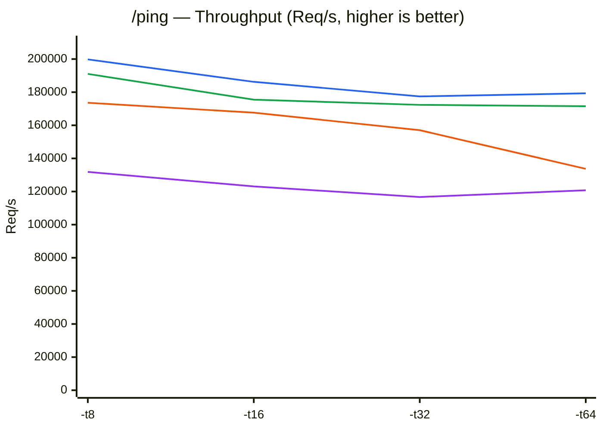
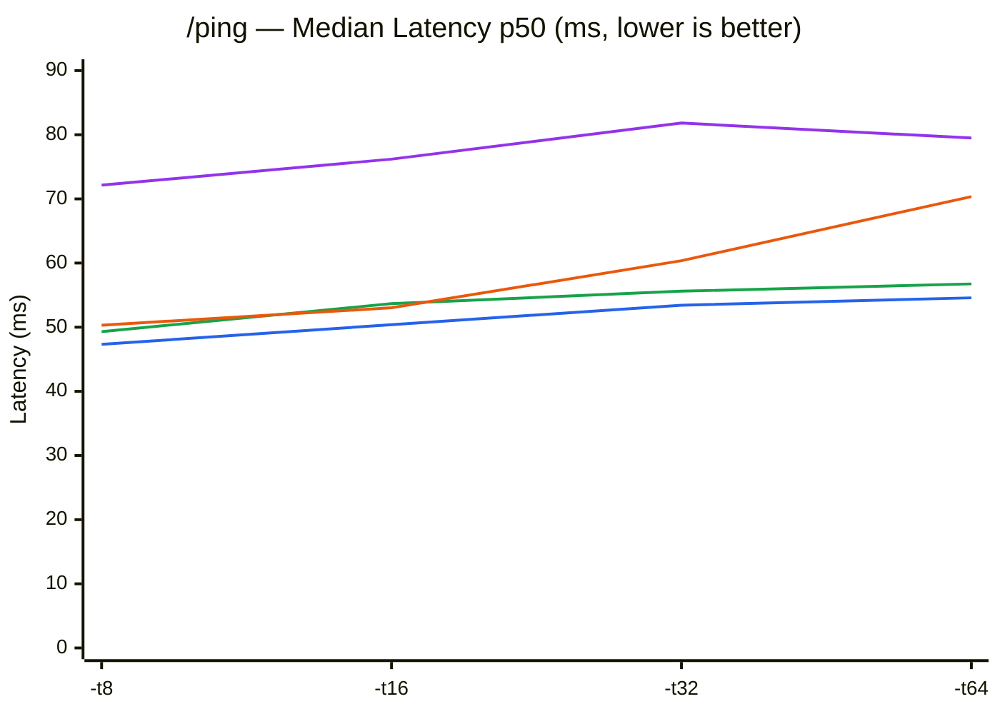
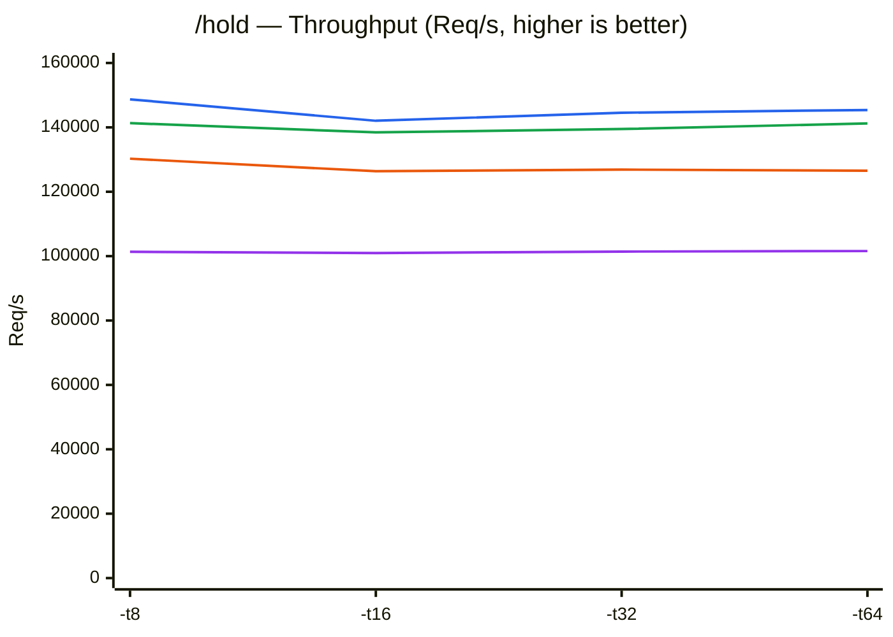
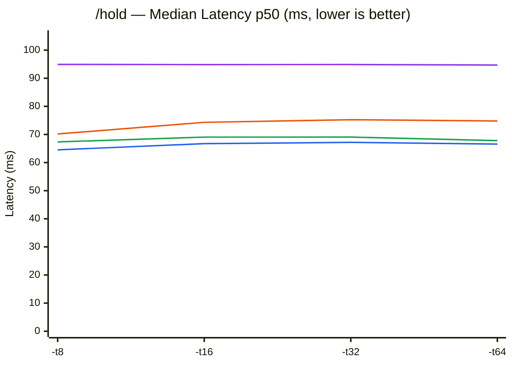

# C10K bench

[`server.py`](server.py): 4-worker `multiprocessing` + `selectors` (`EpollSelector` / `KqueueSelector`) non-blocking HTTP server on `127.0.0.1:8080` (`/ping`, `/hold` 50ms timer, `/metrics`).

## Setup

macOS:

```sh
brew install wrk
sudo sysctl -w kern.ipc.somaxconn=16384
```

Linux:

```sh
sudo apt install wrk
sudo sysctl -w fs.file-max=2000000 net.core.somaxconn=65535 net.ipv4.tcp_max_syn_backlog=65535
sudo sysctl -w net.ipv4.ip_local_port_range="1024 65535" net.ipv4.tcp_tw_reuse=1
sudo sysctl -w kernel.threads-max=4194304 kernel.pid_max=4194304 vm.max_map_count=1048576
```

## Run

```sh
# terminal 1
ulimit -n 65536 && epython server.py

# terminal 2
ulimit -n 65536 && wrk -t8 -c10000 -d30s --timeout 5s --latency http://127.0.0.1:8080/ping
ulimit -n 65536 && wrk -t8 -c10000 -d30s --timeout 5s --latency http://127.0.0.1:8080/hold
```

No `Socket errors:` line means all 10,000 connections completed cleanly with 0 errors.

## Results

Sequential 30s runs (`wrk -t{8,16,32,64} -c10000 -d30s --timeout 5s --latency`, 4 workers, 0 socket errors, 0 non-2xx responses):

### Machine

| Spec | Value |
|---|---|
| **CPU** | AMD EPYC 7B13 (1 socket, 32 cores / 64 threads, x86_64) |
| **Cache** | 1 MiB L1d, 1 MiB L1i, 16 MiB L2, 128 MiB L3 |
| **Memory** | 117 GiB RAM |
| **OS / Kernel** | Debian GNU/Linux, Linux 7.1.6 (`x86_64`, `SMP PREEMPT_DYNAMIC`) |
| **Runtimes** | `EPython 0.1.0` (Erlang/OTP 29, ERTS 17.0.4), `CPython 3.13.18`, `CPython 3.13.6t` (free-threaded), `RustPython 0.6.0` (`rustc 1.100.0`) |
| **Kernel TCP** | `somaxconn=4096`, `tcp_max_syn_backlog=4096`, `ip_local_port_range=1024 65535`, `tcp_tw_reuse=1` |

### `/ping` (keep-alive echo)


Legend: 🟦 **CPython 3.13.18 (GIL)** · 🟩 **CPython 3.13.6t (FT)** · 🟧 **EPython 0.1.0** · 🟪 **RustPython 0.6.0**


Legend: 🟦 **CPython 3.13.18 (GIL)** · 🟩 **CPython 3.13.6t (FT)** · 🟧 **EPython 0.1.0** · 🟪 **RustPython 0.6.0**

<details>
<summary><strong>View detailed /ping numbers (-t8, -t16, -t32, -t64)</strong></summary>

#### `wrk -t8 -c10000 -d30s`

| Interpreter | Req/s | Avg | p50 | p99 | Max | Steady CPU/req (user / sys / total) |
|---|--:|--:|--:|--:|--:|--:|
| **CPython 3.13.18 (GIL)** | 199,800 | 49.44ms | 47.32ms | 71.88ms | 145.64ms | 3.67 / 16.37 / 20.04 µs |
| **CPython 3.13.6t (FT)** | 191,045 | 51.71ms | 49.31ms | 79.68ms | 159.63ms | 4.55 / 16.39 / 20.94 µs |
| **EPython 0.1.0** | 173,621 | 59.19ms | 50.31ms | 171.77ms | 478.46ms | 4.02 / 16.12 / 20.14 µs |
| **RustPython 0.6.0** | 131,855 | 75.14ms | 72.15ms | 104.93ms | 196.89ms | 11.75 / 18.59 / 30.34 µs |

#### `wrk -t16 -c10000 -d30s`

| Interpreter | Req/s | Avg | p50 | p99 | Max | Steady CPU/req (user / sys / total) |
|---|--:|--:|--:|--:|--:|--:|
| **CPython 3.13.18 (GIL)** | 186,242 | 53.27ms | 50.39ms | 77.81ms | 179.80ms | 3.96 / 17.51 / 21.47 µs |
| **CPython 3.13.6t (FT)** | 175,488 | 56.61ms | 53.68ms | 81.40ms | 187.48ms | 4.71 / 18.05 / 22.77 µs |
| **EPython 0.1.0** | 167,611 | 62.57ms | 53.03ms | 266.43ms | 615.23ms | 3.83 / 17.63 / 21.46 µs |
| **RustPython 0.6.0** | 123,085 | 80.67ms | 76.20ms | 116.74ms | 223.92ms | 12.25 / 20.26 / 32.51 µs |

#### `wrk -t32 -c10000 -d30s`

| Interpreter | Req/s | Avg | p50 | p99 | Max | Steady CPU/req (user / sys / total) |
|---|--:|--:|--:|--:|--:|--:|
| **CPython 3.13.18 (GIL)** | 177,451 | 56.07ms | 53.43ms | 80.44ms | 156.16ms | 4.17 / 18.37 / 22.53 µs |
| **CPython 3.13.6t (FT)** | 172,340 | 57.76ms | 55.61ms | 83.16ms | 161.79ms | 4.96 / 18.24 / 23.20 µs |
| **EPython 0.1.0** | 157,056 | 67.48ms | 60.37ms | 327.77ms | 658.27ms | 4.02 / 19.16 / 23.17 µs |
| **RustPython 0.6.0** | 116,677 | 85.26ms | 81.82ms | 118.45ms | 204.90ms | 12.92 / 21.37 / 34.29 µs |

#### `wrk -t64 -c10000 -d30s`

| Interpreter | Req/s | Avg | p50 | p99 | Max | Steady CPU/req (user / sys / total) |
|---|--:|--:|--:|--:|--:|--:|
| **CPython 3.13.18 (GIL)** | 179,332 | 55.69ms | 54.58ms | 78.86ms | 180.84ms | 4.01 / 18.25 / 22.26 µs |
| **CPython 3.13.6t (FT)** | 171,503 | 58.22ms | 56.75ms | 83.12ms | 156.82ms | 4.74 / 18.56 / 23.30 µs |
| **EPython 0.1.0** | 133,704 | 77.73ms | 70.36ms | 281.02ms | 667.81ms | 4.72 / 20.92 / 25.64 µs |
| **RustPython 0.6.0** | 120,751 | 82.61ms | 79.49ms | 117.82ms | 181.06ms | 12.13 / 20.95 / 33.08 µs |

</details>

### `/hold` (50ms min-heap timer per request)


Legend: 🟦 **CPython 3.13.18 (GIL)** · 🟩 **CPython 3.13.6t (FT)** · 🟧 **EPython 0.1.0** · 🟪 **RustPython 0.6.0**


Legend: 🟦 **CPython 3.13.18 (GIL)** · 🟩 **CPython 3.13.6t (FT)** · 🟧 **EPython 0.1.0** · 🟪 **RustPython 0.6.0**

<details>
<summary><strong>View detailed /hold numbers (-t8, -t16, -t32, -t64)</strong></summary>

#### `wrk -t8 -c10000 -d30s`

| Interpreter | Req/s | Avg | p50 | p99 | Max | Steady CPU/req (user / sys / total) |
|---|--:|--:|--:|--:|--:|--:|
| **CPython 3.13.18 (GIL)** | 148,703 | 66.62ms | 64.53ms | 91.86ms | 127.21ms | 4.95 / 21.93 / 26.88 µs |
| **CPython 3.13.6t (FT)** | 141,310 | 70.04ms | 67.35ms | 98.97ms | 135.48ms | 6.12 / 22.18 / 28.30 µs |
| **EPython 0.1.0** | 130,271 | 79.71ms | 70.17ms | 329.46ms | 639.00ms | 6.74 / 23.17 / 29.90 µs |
| **RustPython 0.6.0** | 101,349 | 97.62ms | 94.92ms | 135.58ms | 183.51ms | 15.37 / 24.10 / 39.47 µs |

#### `wrk -t16 -c10000 -d30s`

| Interpreter | Req/s | Avg | p50 | p99 | Max | Steady CPU/req (user / sys / total) |
|---|--:|--:|--:|--:|--:|--:|
| **CPython 3.13.18 (GIL)** | 142,045 | 69.96ms | 66.73ms | 98.10ms | 125.47ms | 5.24 / 22.89 / 28.14 µs |
| **CPython 3.13.6t (FT)** | 138,440 | 71.68ms | 69.06ms | 97.57ms | 133.52ms | 6.39 / 22.48 / 28.87 µs |
| **EPython 0.1.0** | 126,366 | 83.17ms | 74.32ms | 380.80ms | 733.72ms | 6.28 / 23.90 / 30.18 µs |
| **RustPython 0.6.0** | 100,958 | 98.25ms | 94.86ms | 133.31ms | 176.02ms | 15.65 / 23.95 / 39.59 µs |

#### `wrk -t32 -c10000 -d30s`

| Interpreter | Req/s | Avg | p50 | p99 | Max | Steady CPU/req (user / sys / total) |
|---|--:|--:|--:|--:|--:|--:|
| **CPython 3.13.18 (GIL)** | 144,550 | 68.83ms | 67.19ms | 93.03ms | 128.90ms | 5.14 / 22.51 / 27.65 µs |
| **CPython 3.13.6t (FT)** | 139,476 | 71.33ms | 69.07ms | 99.79ms | 125.05ms | 6.40 / 22.27 / 28.67 µs |
| **EPython 0.1.0** | 126,876 | 82.74ms | 75.25ms | 361.72ms | 698.81ms | 6.65 / 24.51 / 31.15 µs |
| **RustPython 0.6.0** | 101,421 | 98.12ms | 94.88ms | 137.49ms | 199.63ms | 15.43 / 23.94 / 39.38 µs |

#### `wrk -t64 -c10000 -d30s`

| Interpreter | Req/s | Avg | p50 | p99 | Max | Steady CPU/req (user / sys / total) |
|---|--:|--:|--:|--:|--:|--:|
| **CPython 3.13.18 (GIL)** | 145,393 | 68.64ms | 66.59ms | 95.81ms | 128.92ms | 5.02 / 22.45 / 27.47 µs |
| **CPython 3.13.6t (FT)** | 141,227 | 70.63ms | 67.81ms | 102.27ms | 145.01ms | 6.16 / 22.14 / 28.29 µs |
| **EPython 0.1.0** | 126,520 | 84.05ms | 74.79ms | 414.26ms | 806.97ms | 6.47 / 25.03 / 31.50 µs |
| **RustPython 0.6.0** | 101,576 | 98.20ms | 94.70ms | 136.17ms | 190.80ms | 15.48 / 23.86 / 39.33 µs |

</details>
