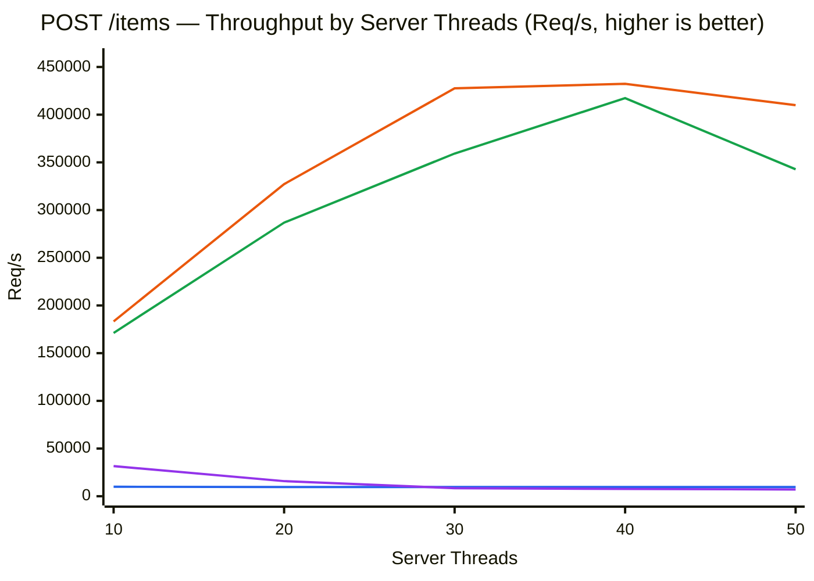
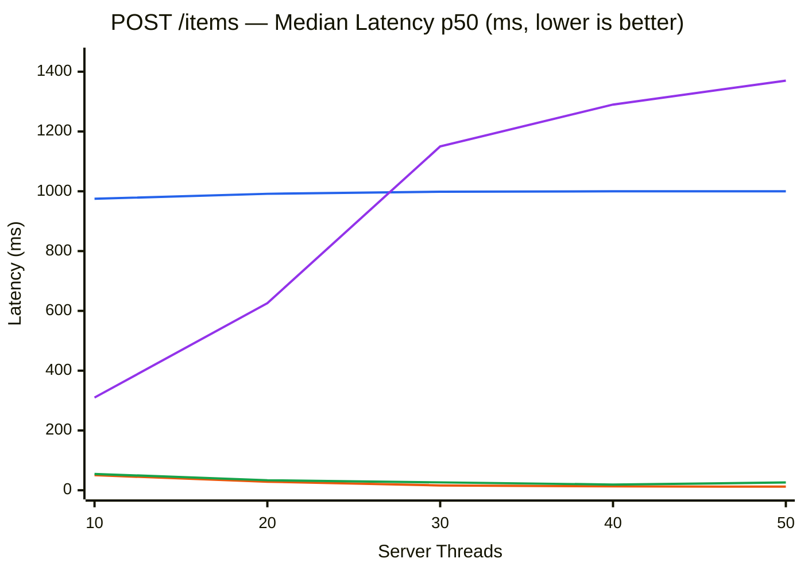
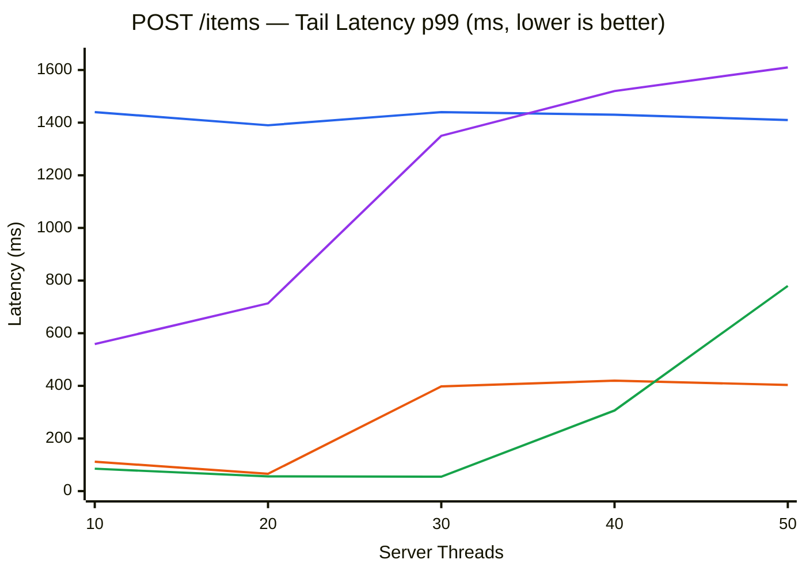

# C10K Multithreaded I/O Benchmark

**EPython — a GIL-free Python interpreter that shines on multithreaded I/O workloads.** Powered by Erlang/OTP's BEAM VM, `EPython` runs Python `threading.Thread` workers concurrently across CPU cores with preemptive scheduling and predictable tail latency — no Global Interpreter Lock, no `multiprocessing` workarounds.

> **Trade-off:** `EPython` is slower than CPython on single-threaded, sequential, or single-loop `asyncio` workloads. Its strength is concurrent multithreaded Python (`threading.Thread` mixing I/O, Python compute, and shared state across many cores).

[`threaded_server.py`](threaded_server.py): multi-threaded `threading.Thread` + `selectors` (`EpollSelector` / `KqueueSelector`) + `SO_REUSEPORT` non-blocking HTTP server on `127.0.0.1:8000` driven by [`post.lua`](post.lua) (`POST /items` JSON payloads). Each request parses HTTP headers and JSON, computes a pure-Python FNV-1a hash (CPU-bound Python bytecode execution), updates a 64-shard shared-memory in-memory store (`SHARDS = [({}, threading.Lock()) for _ in range(64)]`, capped at 200 items per shard), and returns a JSON response.

## Setup

macOS:

```sh
brew install wrk
sudo sysctl -w kern.ipc.somaxconn=16384
```

Linux:

```sh
sudo apt install wrk
sudo sysctl -w fs.file-max=2000000 net.core.somaxconn=65535 net.ipv4.tcp_max_syn_backlog=65535
sudo sysctl -w net.ipv4.ip_local_port_range="1024 65535" net.ipv4.tcp_tw_reuse=1
sudo sysctl -w kernel.threads-max=4194304 kernel.pid_max=4194304 vm.max_map_count=1048576
```

## Run

```sh
# terminal 1 (arguments: [port=8000] [num_threads=cpu_count])
ulimit -n 65536 && epython threaded_server.py 8000 50

# terminal 2
ulimit -n 65536 && wrk -t16 -c10000 -d30s --timeout 5s --latency -s post.lua http://127.0.0.1:8000/items
```

No `Socket errors:` line means all 10,000 connections completed cleanly with 0 errors.

## Results

Strictly sequential 30s runs (`wrk -t16 -c10000 -d30s --timeout 5s --latency -s post.lua http://127.0.0.1:8000/items`) across **10, 20, 30, 40, and 50 server threads** (0 socket errors, 0 non-2xx responses across all 20 runs):

- **Fastest at every thread count tested (10–50 threads)**: `EPython 0.1.0` beats `CPython 3.13.6t (FT)` on throughput, median latency (`p50`), and CPU efficiency (`µs/req`) at all five thread counts — peaking at **`432,361 req/s`** at 40 threads (**`44.8×`** `CPython 3.13.18 (GIL)` and **`56.9×`** `RustPython 0.6.0`), and leading `CPython 3.13.6t (FT)` by **`+19.0%`** at 30 threads (`427,601` vs `359,254 req/s`) and **`+19.6%`** at 50 threads (`409,928` vs `342,737 req/s`).
- **Flat per-request CPU cost across cores**: `EPython 0.1.0` stays nearly flat from 10 → 50 threads (`51.17` → `57.99 µs/req`, using only `24.3` cores to saturate `wrk -t16` at `432k req/s`), whereas `CPython 3.13.6t (FT)` rises from `58.36` → `92.85 µs/req` (`38.8` cores at 40 threads) and degrades to `p99 = 779.68ms` / `max = 1.16s` at 50 threads (`EPython 0.1.0`: `p50 = 12.09ms`, `p99 = 403.49ms`, `max = 537.23ms`).

### Machine

| Spec | Value |
|---|---|
| **CPU** | AMD EPYC 7B13 (1 socket, 32 cores / 64 threads, x86_64) |
| **Cache** | 1 MiB L1d, 1 MiB L1i, 16 MiB L2, 128 MiB L3 |
| **Memory** | 117 GiB RAM |
| **OS / Kernel** | Debian GNU/Linux, Linux 7.1.6 (`x86_64`, `SMP PREEMPT_DYNAMIC`) |
| **Runtimes** | `EPython 0.1.0` (Erlang/OTP 29, ERTS 17.0.4), `CPython 3.13.18`, `CPython 3.13.6t` (free-threaded), `RustPython 0.6.0` (`rustc 1.100.0`) |
| **Kernel TCP** | `somaxconn=4096`, `tcp_max_syn_backlog=4096`, `ip_local_port_range=1024 65535`, `tcp_tw_reuse=1` |

### `POST /items` (JSON + pure-Python FNV-1a hash + 64-shard shared state)


Legend: 🟧 **EPython 0.1.0** · 🟩 **CPython 3.13.6t (FT)** · 🟦 **CPython 3.13.18 (GIL)** · 🟪 **RustPython 0.6.0**


Legend: 🟧 **EPython 0.1.0** · 🟩 **CPython 3.13.6t (FT)** · 🟦 **CPython 3.13.18 (GIL)** · 🟪 **RustPython 0.6.0**


Legend: 🟧 **EPython 0.1.0** · 🟩 **CPython 3.13.6t (FT)** · 🟦 **CPython 3.13.18 (GIL)** · 🟪 **RustPython 0.6.0**

<details>
<summary><strong>View detailed numbers (10, 20, 30, 40, 50 server threads)</strong></summary>

#### 10 server threads (`wrk -t16 -c10000 -d30s`)

| Interpreter | Req/s | Avg | p50 | p99 | Max | Steady CPU/req (user / sys / total) |
|---|--:|--:|--:|--:|--:|--:|
| **EPython 0.1.0** | 183,293 | 55.02ms | 50.46ms | 111.86ms | 410.70ms | 25.92 / 25.25 / 51.17 µs |
| **CPython 3.13.6t (FT)** | 171,193 | 58.00ms | 54.64ms | 85.20ms | 170.67ms | 35.51 / 22.85 / 58.36 µs |
| **RustPython 0.6.0** | 31,548 | 313.45ms | 310.02ms | 558.63ms | 676.07ms | 212.57 / 77.46 / 290.03 µs |
| **CPython 3.13.18 (GIL)** | 9,909 | 986.98ms | 974.89ms | 1.44s | 1.86s | 68.37 / 68.33 / 136.71 µs |

#### 20 server threads (`wrk -t16 -c10000 -d30s`)

| Interpreter | Req/s | Avg | p50 | p99 | Max | Steady CPU/req (user / sys / total) |
|---|--:|--:|--:|--:|--:|--:|
| **EPython 0.1.0** | 327,172 | 30.53ms | 28.47ms | 65.75ms | 294.58ms | 29.40 / 24.29 / 53.69 µs |
| **CPython 3.13.6t (FT)** | 286,849 | 34.63ms | 33.56ms | 55.86ms | 140.98ms | 45.25 / 24.35 / 69.60 µs |
| **RustPython 0.6.0** | 15,829 | 621.87ms | 625.85ms | 713.43ms | 1.15s | 402.02 / 375.15 / 777.17 µs |
| **CPython 3.13.18 (GIL)** | 9,726 | 1.01s | 991.63ms | 1.39s | 2.26s | 69.45 / 70.65 / 140.09 µs |

#### 30 server threads (`wrk -t16 -c10000 -d30s`)

| Interpreter | Req/s | Avg | p50 | p99 | Max | Steady CPU/req (user / sys / total) |
|---|--:|--:|--:|--:|--:|--:|
| **EPython 0.1.0** | 427,601 | 33.99ms | 16.21ms | 397.84ms | 532.47ms | 32.11 / 24.80 / 56.91 µs |
| **CPython 3.13.6t (FT)** | 359,254 | 27.46ms | 26.35ms | 54.78ms | 119.59ms | 53.71 / 25.29 / 78.99 µs |
| **CPython 3.13.18 (GIL)** | 9,712 | 1.01s | 998.53ms | 1.44s | 2.13s | 68.69 / 71.78 / 140.46 µs |
| **RustPython 0.6.0** | 8,500 | 1.15s | 1.15s | 1.35s | 2.54s | 554.07 / 733.87 / 1,287.93 µs |

#### 40 server threads (`wrk -t16 -c10000 -d30s`)

| Interpreter | Req/s | Avg | p50 | p99 | Max | Steady CPU/req (user / sys / total) |
|---|--:|--:|--:|--:|--:|--:|
| **EPython 0.1.0** | 432,361 | 45.67ms | 12.93ms | 419.68ms | 532.17ms | 30.57 / 25.60 / 56.18 µs |
| **CPython 3.13.6t (FT)** | 417,353 | 25.43ms | 19.04ms | 306.35ms | 674.89ms | 66.26 / 26.60 / 92.85 µs |
| **CPython 3.13.18 (GIL)** | 9,656 | 1.01s | 1.00s | 1.43s | 2.42s | 69.38 / 72.49 / 141.87 µs |
| **RustPython 0.6.0** | 7,597 | 1.28s | 1.29s | 1.52s | 2.76s | 616.71 / 816.06 / 1,432.77 µs |

#### 50 server threads (`wrk -t16 -c10000 -d30s`)

| Interpreter | Req/s | Avg | p50 | p99 | Max | Steady CPU/req (user / sys / total) |
|---|--:|--:|--:|--:|--:|--:|
| **EPython 0.1.0** | 409,928 | 45.82ms | 12.09ms | 403.49ms | 537.23ms | 31.52 / 26.47 / 57.99 µs |
| **CPython 3.13.6t (FT)** | 342,737 | 45.69ms | 26.05ms | 779.68ms | 1.16s | 63.48 / 28.00 / 91.49 µs |
| **CPython 3.13.18 (GIL)** | 9,682 | 1.01s | 1.00s | 1.41s | 2.22s | 68.34 / 73.76 / 142.10 µs |
| **RustPython 0.6.0** | 7,101 | 1.37s | 1.37s | 1.61s | 2.89s | 679.88 / 886.66 / 1,566.54 µs |

</details>
